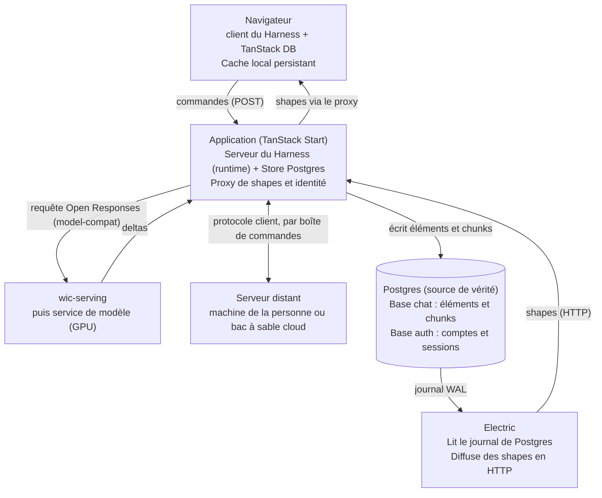

# Specs du chat : application construite sur le Harness

## Objectifs et contraintes

Le chat est une application construite sur le Harness (voir la page Specs du Harness) : elle embarque le serveur du Harness (boucle, outils, appels au modèle) et sert des clients web ; le format du journal et le protocole client viennent du Harness, et cette page ne décrit que ce qui est propre au chat (base de données, synchro, streaming, identité, rendu et déploiement). Il est entièrement auto-hébergeable et Postgres en est la seule source de vérité.

- Interface sur le Harness : le chat n'a ni boucle ni format de conversation propres ; il fournit l'implémentation Postgres du `Store`, le transport Electric du protocole client et ses propres outils.
- Auto-hébergement total : un `docker compose up` suffit, sans service externe ni dépendance cloud.
- Postgres fait foi. Le client est un miroir local qui converge vers le serveur ; en cas de collision, le serveur gagne.
- Règle de durabilité : rien n'est envoyé au client tant que ce n'est pas écrit et validé (committed) en base.
- Composants petits et remplaçables, aux licences compatibles avec l'AGPL-3.0-or-later du monorepo (voir la page Wica) : changer la couche de synchronisation ne doit faire perdre aucune donnée.
- Expérience : contenu affiché dès l'arrivée (rendu serveur en flux), cache local persistant dès la V1, pas de saut de mise en page gênant.
- Cible : web. TanStack DB, le cache local SQLite et le rendu serveur appartiennent à cette application web seulement ; une application mobile ou de bureau est une autre application, qui réutilise les paquets TypeScript du Harness avec sa propre synchro.
- Décisions prises : les tokens du GPU sont écrits dans Postgres (pas de Durable Streams) ; la persistance locale est incluse dès la V1.
- Déploiement de la V1 (décision du projet) : l'application tourne en serverless sur Cloudflare Workers, avec Postgres et Electric sur un hôte allumé en permanence. Le même code tourne aussi en un seul processus Node dans le `docker compose up` d'un VPS. Les deux déploiements ne diffèrent que par les implémentations branchées sur les interfaces du Harness.

Identité : l'application ne connaît que des comptes, des organisations et des clés d'API ; tout système d'identité se branche par un adaptateur (voir Identité et authentification), ce qui permet à une entreprise d'auto-héberger avec son propre système.

## Place du chat dans le Harness

| Besoin du chat | Fourni par le Harness | Ce que le chat ajoute |
| --- | --- | --- |
| Boucle d'agent, outils, autorisation | `runtime` (`createHarness`), `defineTool`, `authorize` | Outils du chat, politique d'autorisation liée au `Principal` |
| Journal de conversation | Format `Item` en arbre, invariants | Tables `items` et `item_chunks` dans Postgres |
| Persistance | Interface `Store` | Implémentation Postgres du `Store` |
| Exécution sans état | `claim` et `append(items, epoch)` du `Store`, `Scheduler`, `SessionStore`, `CredentialStore` | Implémentations Postgres, file de reprise, tables `sessions` et `model_credentials` |
| Serveur distant | `CommandInbox`, paquet `transport-inbox` | Shape Electric sur `commands`, API HTTP du `Store` |
| Lecture côté interface | Paquet `client` (vue dérivée du journal) et protocole client | Transport Electric, collections TanStack DB, cache local |
| Exécution des outils | `runtime` et `tools-node`, dans le serveur | Serveur embarqué sans outils système ; outils système par un serveur distant via la boîte de commandes, jeton par serveur |
| Modèle | `model-compat` | Appel de wic-serving en Open Responses, devant le service de modèle (GPU) ; fournisseurs hébergés par `model-pi`, clés d'API et abonnements (jeton chiffré par compte, avertissement unique à la première connexion) |

## Architecture

L'application est le seul point d'entrée : elle embarque le serveur du Harness, qui écrit dans Postgres et sert de proxy à Electric, qui diffuse aux clients ce que Postgres a validé.



- Postgres : seule source de vérité. La base `chat` appartient à l'application ; une base `auth` n'existe que dans le déploiement de référence.
- Electric : lit le journal de transactions de Postgres et diffuse des shapes en HTTP ; il ne reçoit jamais d'écriture.
- Application (TanStack Start) : embarque le serveur du Harness, résout le `Principal` par adaptateur d'identité, expose l'API de commandes (`send`, `answer`, `interrupt`, `set_head`), proxy des shapes, rendu serveur en flux.
- Client (paquet `client` du Harness et TanStack DB) : collections synchronisées, requêtes live, cache local persistant.
- Service de modèle (GPU) : produit les tokens, appelé à travers wic-serving par l'adaptateur de modèle du serveur, uniquement depuis l'application.
- Serveur distant (machine de la personne ou bac à sable cloud) : un serveur du Harness avec accès au système, qui suit la boîte de commandes du chat et y écrit par le Store en HTTP. Le serveur embarqué, lui, n'exécute pas d'outils système.
- Service d'auth (optionnel, hors schéma) : Better Auth, OIDC et OAuth 2.1, dans le déploiement de référence. L'application ne le voit que comme un fournisseur OIDC.

## Modèle de données

Une instance Postgres héberge la base `chat`, qui appartient à l'application. Dans le déploiement de référence, une base `auth` s'y ajoute pour le service d'auth séparé.

- `chat` : accessible au rôle `chat_app` (l'application) et au rôle `electric` (attribut `REPLICATION`, lecture seule pour la synchro). Electric ne se connecte qu'à cette base.
- `auth` (déploiement de référence seulement) : tables gérées par Better Auth (sa CLI génère et applique le schéma), rôle `auth_app`. L'application n'y accède jamais : elle ne connaît ce service que comme fournisseur OIDC.
- L'identité vue par l'application vit dans `chat` (tables `users`, `identities`, `organizations`, `memberships`, `api_keys`, `verified_domains`) : les références du chat peuvent donc être de vraies clés étrangères.

| Table (base `chat`) | Colonnes clés | Rôle |
| --- | --- | --- |
| `users` | `id` (UUID v7), `display_name`, `created_at` | Compte interne, identifiant stable |
| `identities` | PK (`provider`, `subject`), `user_id` | Lie une identité externe à un compte interne |
| `organizations` | `id`, `name`, `created_at` | Une organisation |
| `memberships` | PK (`organization_id`, `user_id`), `roles` | Appartenances et rôles |
| `api_keys` | `id`, `key_hash`, `user_id` ou `organization_id`, `scopes`, `created_at`, `revoked_at` | Clés d'API hachées |
| `verified_domains` | `organization_id`, `domain`, `verified_at` | Prévue dès la V1 pour le SSO d'entreprise (phase 2) |
| `conversations` | `id` (UUID v7), `owner_id`, `title`, `head_item_id`, `last_seq`, `id_salt`, `created_at`, `updated_at` | Une discussion ; `head_item_id` désigne la branche affichée, `last_seq` numérote les éléments, `id_salt` est le sel de conversation défini dans la page Specs du Harness |
| `items` | `id` (UUID v8 déterministe, voir la page Specs du Harness), `conversation_id`, `parent_id`, `seq`, `kind`, `payload` (JSONB), `status`, `created_at` | Un élément du journal, format défini dans la page Specs du Harness |
| `item_chunks` | PK (`item_id`, `idx`), `conversation_id`, `text`, `created_at` | Lots de tokens écrits pendant le flux |

Règles :

- `status` d'un élément prend les valeurs `streaming`, `done`, `interrupted`, `failed` ; il ne change que pendant le flux.
- Les clés primaires de `items` et de `item_chunks` rendent chaque écriture rejouable sans doublon (idempotence).
- `parent_id` référence un élément de la même conversation ; `seq` croît strictement par conversation et le parent d'un élément a toujours un `seq` inférieur (pas de cycle).
- Sous-agents (décision raisonnée, à confirmer) : une conversation enfant est une ligne de `conversations` avec une colonne `parent_call_id` à ajouter au modèle. La liste des conversations n'affiche que celles où `parent_call_id` est nul, et l'accès à une conversation enfant se déduit de celui de sa conversation parente.
- Implémentations des interfaces du Harness (décision raisonnée, à confirmer) : le `Store` Postgres réclame une conversation par un UPDATE conditionnel qui incrémente `writer_epoch` et pose `lease_until`, et refuse tout `append` dont l'`epoch` n'est pas celui de la ligne ; il lit `interrupt_requested_at` dans la même transaction que l'écriture d'un lot. Le `Scheduler` s'appuie sur Cloudflare Queues sur Workers, et sur une table de reprise lue avec `FOR UPDATE SKIP LOCKED` par le processus de l'application dans le Compose. Le `SessionStore` écrit dans `sessions`. Le `CredentialStore` écrit dans `model_credentials` et rafraîchit un jeton sous `SELECT ... FOR UPDATE`. La `CommandInbox` est décrite dans la section Serveurs distants.
- Boîte de commandes, sessions, serveurs (hypothèse, à confirmer) : trois tables. `commands` (`id` généré par le client, `conversation_id`, `server_id` nul pour le serveur embarqué, `kind`, `payload`, `created_at`, `acked_at`) dépose les requêtes du client ; le serveur embarqué les consomme dans ses tours, un serveur distant les suit par une shape filtrée sur son `server_id`. `sessions` (`id`, `user_id`, `server_id`, `tools_hash`, `state` JSONB, `created_at`, `expires_at`, `last_seen_at`) garde la session décrite dans le Harness. `servers` (`id`, `owner_id`, `name`, `token_hash`, `last_seen_at`, `revoked_at`) enregistre les serveurs distants et leur battement de cœur. Le jeton de clôture est porté par `conversations` : colonnes `writer_epoch`, `lease_until` et `interrupt_requested_at`.
- Identifiants de modèle (décision raisonnée, à confirmer) : une table `model_credentials` (`id`, `user_id`, `provider`, `kind` clé d'API ou OAuth, `ciphertext`, `key_id`, `created_at`, `revoked_at`, `warned_at`) garde les jetons que les personnes connectent, chiffrés avec une clé d'instance. Elle n'a aucune shape, le rôle `electric` n'a aucun droit dessus, et ses valeurs ne vont jamais dans `items` ni dans le journal. `warned_at` marque l'avertissement unique de la première connexion d'un abonnement. Le chat branche le callback `onFirstSubscriptionUse` du Harness pour afficher cet avertissement, puis écrit `warned_at`.
- Tri d'affichage : chunks par `idx`. `created_at` est fixé par le serveur, jamais par le client.
- Proposition : à la fin d'un flux, la même transaction écrit le contenu complet dans `payload`, passe `status` à `done` et supprime les chunks de l'élément. Les suppressions se propagent aux clients par la synchro.
- Partage (décision raisonnée, hypothèse à confirmer) : les shapes d'éléments et de chunks sont par conversation et n'ont besoin d'aucune jointure, puisque le proxy vérifie l'accès à la conversation avant de fixer le filtre. Seule la liste des conversations pose question : plutôt qu'une jointure, une colonne `organization_id` dénormalisée sur `conversations`, sous réserve de ce que permettent les clauses `where` d'Electric (à lire dans leur documentation). Propriétaire unique en V1.

## Journal de conversation : correspondance avec la base

Le format du journal (éléments typés, arbre, invariants) est défini une seule fois dans la page Specs du Harness. Le chat stocke chaque élément dans `items` : `kind` et `payload` reprennent le type `Item`, `parent_id` porte l'arbre, `seq` l'ordre. Dans la suite de cette page, "message" désigne un élément `user_message` ou `assistant_text`.

Règles propres à la base :

- `seq` est attribué par la transaction d'écriture, en verrouillant la ligne de `conversations` (`last_seq`). Il ordonne les éléments frères ; la structure vient de `parent_id`.
- `head_item_id` désigne la branche affichée. La commande `set_head` le modifie ; le changement se synchronise aux autres clients, et la dernière écriture l'emporte.
- Ajout seul : un élément n'est ni effacé ni modifié, sauf la transition de `status` pendant son flux.
- Effacement (décision raisonnée, à confirmer) : la règle générale est dans les specs du Harness. Ici, l'effacement d'une conversation se fait en cascade par clés étrangères sur `items`, `item_chunks` et les conversations enfants, et un ramasse-miettes libère les blobs qu'aucun élément ne référence plus. La suppression se propage aux clients par la synchro.
- Gros résultats d'outils : référence vers un blob (`uri`, `sha256`) et aperçu tronqué dans `payload`, avec un seuil de taille à définir, pour ne pas synchroniser de grosses lignes.
- Compaction : un élément `event` de nom `compacted` remplace une plage dans la vue d'un chemin, sans rien supprimer.
- Provenance (décision raisonnée, à confirmer) : le chat renseigne `from` avec le canal `web`, l'identifiant interne de l'auteur et la confiance `owner` pour le propriétaire de la conversation ; `from` et `to` sont stockés dans `payload`. Les autres canaux de messagerie sont hors V1. Les réponses aux questions partent par `answer` avec `as: 'user'` et le `from` du canal `web` ; les formulaires de questions viennent des types de `tools-user`.
- Reprise d'une ancienne branche : règle de l'événement `branch_resumed` dans les specs du Harness.

## Identité et authentification

Le cœur de l'application ne connaît que des comptes, des organisations et des clés d'API, de façon abstraite ; tout système d'identité se branche par un adaptateur, y compris celui d'une entreprise qui auto-héberge.

```ts
type Principal = {
  id: string                      // identifiant interne stable
  kind: 'user' | 'apiKey'
  orgs: { id: string; roles: string[] }[]
  scopes: string[]
}
interface AuthProvider {
  authenticate(req: Request): Promise<Principal | null>
}
```

Règles du cœur :

- Il ne voit que le `Principal` : jamais de mot de passe, de session de fournisseur ni de SAML.
- Le `Principal` est transmis au contexte de `authorize` du Harness, pour que la politique d'autorisation des outils tienne compte du compte et de l'organisation. Le chat implémente aussi `ClientAuth` du Harness avec cet adaptateur d'identité.
- Une table d'identités relie (fournisseur, sujet externe) à un compte interne. Toutes les références (par exemple `owner_id`) pointent sur l'identifiant interne, pour qu'un changement de fournisseur ne casse aucune donnée.
- Les clés d'API appartiennent à l'application : stockées hachées, avec leurs scopes, rattachées à un compte ou à une organisation. Quotas et abonnement relèvent de l'application, pas du fournisseur d'identité.
- Organisations et appartenances sont des tables de l'application, alimentées par des claims dont les noms sont configurables, ou par création à la première connexion (just-in-time).
- Navigateur : après le retour du fournisseur OIDC (code d'autorisation avec PKCE), l'application émet son propre cookie de session signé, lié à l'identifiant interne (hypothèse de conception, à confirmer).
- Hypothèse : si une deuxième application rejoint le monorepo, ce bloc devient un paquet partagé.

| Adaptateur | Fonctionnement | Livraison |
| --- | --- | --- |
| Amorçage (par défaut) | Clés d'API plus un jeton d'admin initial ; ni mots de passe ni sessions dans le cœur | V1 |
| OIDC générique | Émetteur (issuer) et clés publiques (JWKS) par découverte ; noms des claims d'organisation et de rôles configurables | V1 |
| Proxy de confiance | Un reverse proxy authentifie (par exemple Authelia, oauth2-proxy) et l'application lit un en-tête, uniquement depuis l'adresse du proxy | V1 |
| SAML, SCIM, portail d'admin | Pont en amont d'OIDC, par exemple [Ory Polis](https://github.com/ory/polis) (Apache 2.0) | Phase 2 |

Déploiement de référence : un service d'auth séparé avec Better Auth, qui joue le rôle de fournisseur OIDC et de serveur OAuth 2.1 ([plugin OAuth 2.1 Provider](https://better-auth.com/docs/plugins/oauth-provider.md)). L'application le configure comme n'importe quel fournisseur OIDC : aucun code propre à Better Auth dans le cœur. L'OAuth sert à connecter un compte à une appli tierce ; c'est l'API de tokens de l'application qui vérifie l'abonnement et décompte le quota.

Points de vigilance :

- Validation d'un jeton : émetteur, audience, algorithme autorisé, expiration et décalage d'horloge, jamais d'algorithme `none`.
- Proxy de confiance : supprimer l'en-tête d'identité fourni par le client et ne l'accepter que depuis le proxy, sinon n'importe qui peut en usurper un autre.
- L'abstraction fuit sur la déconnexion, le rafraîchissement, la révocation et la synchro des appartenances : ces cas sont définis dans le contrat de l'adaptateur.
- Phase 2 : SCIM, portail d'admin en libre-service, SSO d'entreprise, vérification de domaine (la table existe dès la V1), journaux d'audit.

## Proxy des shapes et autorisation

Toute requête de synchro passe par l'application, qui résout le Principal via l'adaptateur d'identité puis fixe elle-même la shape demandée ; le client n'atteint jamais Electric directement ([guide d'auth d'Electric](https://electric.ax/docs/sync/guides/auth)).

1. L'adaptateur d'identité configuré (amorçage, OIDC ou proxy de confiance) authentifie la requête et renvoie un `Principal`.
2. Le client appelle une route proxy de l'application (par exemple `/api/shapes/messages`) avec sa session ou son jeton.
3. Le proxy refuse (401) sans `Principal` valide, puis ne transmet à Electric que les paramètres du protocole de synchro.
4. Le proxy fixe côté serveur `table` et `where` (par exemple `owner_id = $1`, ou l'appartenance à une organisation pour ses conversations) ; le client ne choisit jamais le filtre.
5. Le proxy ajoute le secret d'Electric (`ELECTRIC_SECRET`) à la requête amont. Ce secret n'est jamais envoyé au navigateur.
6. La réponse revient au client après retrait des en-têtes `content-encoding` et `content-length`, avec `Vary: Authorization` ou `Vary: Cookie`.

Points de vigilance :

- Sans `Vary`, navigateurs et caches peuvent resservir une shape après la déconnexion.
- À la déconnexion, recharger la page entière : les données restent sinon en mémoire côté client. Avec la persistance locale, vider aussi le cache local à la déconnexion (à spécifier lors de l'implémentation).
- Le jeton peut expirer pendant un flux : les en-têtes du client sont résolus par fonction à chaque requête, et une erreur 401 déclenche un rafraîchissement puis une nouvelle tentative.
- Variante écartée en V1 : le "gatekeeper" (jeton limité à une shape). Le proxy vérifie chaque requête, ce qui évite les jetons périmés.

## Écriture des messages

Le client affiche son message tout de suite, l'API l'écrit en une transaction, et la synchro le confirme : l'écriture ne passe jamais par Electric ([collection Electric de TanStack DB](https://tanstack.com/db/latest/docs/collections/electric-collection)). Côté Harness, c'est la commande `send` du protocole client.

1. Le client calcule l'`id` de l'élément `user_message` avec la fonction de hachage du Harness (sel de la conversation, parent, provenance, contenu) et l'insère dans sa collection locale : l'insertion est optimiste.
2. Le handler `onInsert` appelle l'API (`POST`) avec cet `id`.
3. L'API vérifie la session et le droit d'écrire dans la conversation, puis dépose la commande et, pour le serveur embarqué, exécute un tour court : il réclame la conversation et écrit dans une transaction unique, via le `Store`.
4. Dans cette même transaction, elle lit `SELECT pg_current_xact_id()::xid::text` et renvoie le `txid` au client.
5. Le handler appelle `collection.utils.awaitTxId(txid)` : la mise à jour optimiste est confirmée quand la ligne arrive par la synchro.
6. En cas d'erreur de l'API, l'insertion optimiste est annulée automatiquement.

Règles :

- Le `txid` doit être lu dans la même transaction que l'écriture. Sinon `awaitTxId` bloque en silence jusqu'au délai maximal.
- Rejouer le même `POST` avec le même `id` ne crée pas de doublon : la clé primaire l'empêche et l'API répond comme pour un succès.
- Si l'API ne peut pas renvoyer de `txid`, l'alternative documentée est `awaitMatch` (délai par défaut : 15 s).
- La requête n'attend jamais le modèle (décision raisonnée, à confirmer) : après le tour court, l'appel au modèle part en file de reprise et s'exécute dans un tour long, qui écrit ses lots comme décrit plus bas.
- Les lots de tokens écrits par le runtime n'ont pas besoin de `txid` : aucun client n'attend leur confirmation.
- Avec la persistance locale activée, `awaitTxId` peut se résoudre avant la fin de l'écriture locale : il ne garantit pas la durabilité sur le disque du navigateur.

## Serveurs distants

Un serveur distant est un serveur du Harness (voir la page Specs du Harness) qui sert des conversations du chat depuis la machine d'une personne ou un bac à sable cloud. Le chat lui fournit les deux interfaces dont il a besoin ; le contrat est dans le Harness, ce qui suit n'est que l'implémentation du chat.

Règles (hypothèse, à confirmer par un essai) :

- `CommandInbox` : une shape Electric sur la table `commands`, filtrée sur le `server_id` du serveur, suivie par une connexion sortante et reprise par offset. L'acquittement écrit `acked_at`.
- `Store` distant : l'application expose une API HTTP authentifiée par le jeton du serveur. Elle applique les mêmes écritures que pour le serveur embarqué (réclamation, `append` avec `epoch`, chunks) après avoir vérifié que le propriétaire du serveur peut écrire dans la conversation.
- Le client web ne distingue pas serveur embarqué et serveur distant : `conversations.server_id` est nul pour l'embarqué, et la commande est déposée dans `commands` dans les deux cas, le serveur embarqué la consommant dans ses tours.
- Hors ligne : `servers.last_seen_at` alimente l'indication « serveur hors ligne » ; les commandes restent en attente tant que la personne ne renonce pas.
- Le saut supplémentaire (dépôt, réplication Electric, lecture par le serveur) s'ajoute à la latence perçue ; à mesurer au premier prototype.
- Politique du chat : le serveur embarqué n'a aucun outil système ; les outils de fichiers et de shell n'existent que sur un serveur distant.

## Streaming des tokens du GPU

Les tokens sont écrits dans Postgres par petits lots, puis Electric les pousse aux clients : la règle "rien n'est envoyé avant d'être écrit" est vraie par construction, car Electric ne diffuse que des lignes validées.

1. Le runtime du Harness, seul à écrire sur cette branche, crée via le `Store` l'élément avec `status = streaming`, son `parent_id` et le `seq` suivant, dans une transaction.
2. Il reçoit les deltas de l'adaptateur de modèle et les accumule pendant une courte fenêtre (valeur de départ : 50 à 100 ms, à mesurer).
3. Chaque lot devient une ligne de `item_chunks` avec le `idx` suivant. Un INSERT par lot, jamais par token.
4. Le client assemble les chunks de l'élément par `idx` croissant dans une requête live.
5. À la fin, une seule transaction écrit le contenu dans `payload`, passe `status` à `done` et supprime les chunks de l'élément.

| `status` | Sens | Transition |
| --- | --- | --- |
| `streaming` | Le GPU produit encore des tokens pour cet élément | vers `done`, `interrupted` ou `failed` |
| `done` | Contenu complet dans `payload` | final |
| `interrupted` | Le flux a été coupé (redémarrage du serveur, arrêt demandé) | final en V1 |
| `failed` | Erreur du GPU ou de l'API | final |

Règles :

- Quand un tour réclame une conversation dont le bail précédent (`lease_until`) a expiré, tout élément encore en `streaming` passe en `interrupted` : en serverless, aucun processus ne voit de démarrage. Pour le reste, la règle de reprise est celle de la boucle du Harness (décision raisonnée, à confirmer par un essai) : un appel d'outil laissé sans résultat par l'arrêt du processus reçoit un `tool_result` d'erreur d'état inconnu et n'est pas relancé, et les appels du canal utilisateur (question, approbation) restent en attente, pour qu'un déploiement n'annule pas des questions que la personne n'a pas encore vues. V1 : serverless, donc plusieurs invocations simultanées sont le cas normal, et la correction vient du jeton de clôture `writer_epoch` (voir le Harness) ; le Compose, avec un seul processus, applique les mêmes règles.
- Chaque lot de chunks est écrit avec le `writer_epoch` du tour et lit, dans la même transaction, `interrupt_requested_at` : un tour périmé est refusé, et une interruption demandée arrête le flux au prochain lot (décision raisonnée, à confirmer).
- Après une coupure réseau, le client reprend là où il s'était arrêté grâce à la synchro d'Electric ; la clé primaire (`item_id`, `idx`) écarte les doublons.
- Les tokens déjà écrits survivent à un plantage du tour : c'est le gain de la règle "écrire d'abord".
- Délai perçu = fenêtre de lot + validation + réplication jusqu'à Electric + livraison HTTP. Il se mesure dès le premier prototype (voir Tests).
- Plan B documenté mais non retenu : [Durable Streams](https://electric-sql.com/blog/2025/12/09/announcing-durable-streams), si la charge d'écriture devenait un problème.

## Synchro client et cache local persistant

Electric livre les changements de Postgres, TanStack DB les range dans des collections interrogeables en direct, et la persistance locale (SQLite) garde ce cache entre deux visites ([page Sync d'Electric](https://electric.ax/sync/)). Le paquet `client` du Harness dérive de ces collections la vue pour l'écran.

- Une collection par table synchronisée (`conversations`, `items`, `item_chunks`), alimentée par une shape filtrée par le proxy.
- Les interfaces lisent via des requêtes live (par exemple : éléments du chemin actif d'une conversation avec leurs chunks), qui ne redessinent que ce qui change. Le chemin actif se calcule côté client en remontant les `parent_id` depuis `head_item_id`.
- Electric garde un offset par shape et reprend là où le client s'est arrêté après une coupure.
- Persistance locale incluse dès la V1 : `persistedCollectionOptions` enveloppe la collection Electric avec un stockage SQLite durable.

Limites documentées à respecter :

- `awaitTxId` peut se résoudre avant la fin de l'écriture locale : ne pas le traiter comme une garantie de durabilité.
- Une reprise depuis le cache exige un adaptateur de persistance capable de vérifier l'hydratation ; sinon Electric avertit et repart d'un instantané neuf.
- Une reprise rejette les mises à jour partielles de lignes inconnues, arrête le flux et demande `collection.reload()`.
- Si Electric réessaie après une requête échouée, la collection ne signale rien ; elle n'échoue qu'une fois le flux abandonné. L'interface doit donc gérer un état "synchro en attente".
- Les attentes en cours (`awaitTxId`, `awaitMatch`) sont rejetées avec `StreamAbortedError` au nettoyage ou au remplacement de session.
- Sources : [documentation de la collection Electric](https://tanstack.com/db/latest/docs/collections/electric-collection). Les détails du stockage SQLite dans le navigateur ne sont pas vérifiés : prototype requis.

Cache local (décision raisonnée, à confirmer par un essai) : Postgres fait foi, donc le cache est jetable, à une exception près : les écritures optimistes non encore confirmées, seules données qui ne se retrouvent pas côté serveur. On évince donc par ancienneté d'ouverture avec un quota, sans jamais évincer ces écritures. Le cache est cloisonné par identifiant de compte, pour que deux comptes sur un même navigateur ne partagent rien, et vidé à la déconnexion explicite.

## Rendu serveur en flux et arrivée sur l'appli

La coque de la page part immédiatement, puis chaque zone de données arrive dans le même flux HTTP dès qu'elle est prête, au lieu d'attendre toute la page ([guide SSR de TanStack DB](https://tanstack.com/db/latest/docs/guides/ssr)).

1. Envoyé tout de suite : mise en page, cadre de la barre latérale, en-tête, zone de saisie. Aucune donnée requise.
2. Zones lentes dans leur propre frontière de chargement (`Suspense`) : liste des conversations d'un côté, messages de l'autre.
3. Règle : ce qui répond en quelques millisecondes et définit l'écran (environ les 30 derniers éléments du chemin actif de la conversation ouverte) est attendu ; le reste est streamé.
4. Le navigateur s'hydrate avec les lignes envoyées, puis la synchro prend le relais par un passage unique de l'instantané au résultat live.

Mise en œuvre documentée :

- Un `DbClient` neuf par requête serveur ; `routerWithDbClient` (paquet `@tanstack/react-router-with-db`) l'ajoute au contexte du routeur.
- Les composants lisent avec `useLiveSuspenseQuery` dans un `Suspense`, avec une identité de requête stable ou un `queryKey` explicite.
- Le serveur ne synchronise pas Electric : il précharge des lignes (par exemple via une requête Postgres) et les sérialise dans le HTML.

Points de vigilance :

- La documentation de TanStack DB se contredit selon la version : une fiche ancienne (0.6.2) dit que le SSR n'est pas supporté, le guide officiel de la 1.0 RC le décrit. Prototype SSR obligatoire avant d'écrire le reste. Repli : garder la coque rendue serveur et désactiver le SSR (`ssr: false`) sur les routes de données.
- Un préchargement qui n'aboutit jamais peut rester en attente : `preloadLiveQuery()` n'a ni délai ni `AbortSignal`. Prévoir un délai maximal côté serveur.
- Une lecture non préchargée lève une erreur pendant le rendu serveur.
- Un client navigateur accumule les préchargements propres aux routes sans règle de durée de vie : à définir.

Expérience visuelle :

- Réserver la place de ce qui arrive plus tard : dimensions fixes pour avatars et images, squelettes de même hauteur que le contenu final, polices préchargées avec une police de secours aux métriques ajustées.
- Ce qui apparaît dans un conteneur dont la taille est réservée ne déplace rien : la barre latérale peut s'animer (apparition échelonnée) en n'animant que l'opacité et le déplacement (`transform`), jamais la hauteur. Respecter `prefers-reduced-motion`.
- Ne rejouer l'animation que pour ce qui est réellement nouveau : au retour, le cache local persistant affiche tout de suite.
- Liste de messages : ancrer le défilement sur le message regardé quand d'anciens messages se chargent au-dessus ; coller en bas pendant le flux seulement si la personne était déjà en bas.

## Déploiement Docker Compose et exploitation

Le déploiement tient en trois conteneurs : Postgres avec son volume, Electric, et l'application ([installation d'Electric](https://electric.ax/docs/guides/installation)).

```yaml
services:
  db:
    image: postgres:17
    command: ["postgres", "-c", "wal_level=logical"]
    volumes:
      - pgdata:/var/lib/postgresql/data
      - ./initdb:/docker-entrypoint-initdb.d:ro
  electric:
    image: electricsql/electric
    environment:
      DATABASE_URL: postgresql://electric:...@db:5432/chat
      ELECTRIC_SECRET: ...
    volumes:
      - electric_data:/var/lib/electric
    depends_on: [db]
  app:
    build: .
    depends_on: [db, electric]
volumes:
  pgdata:
  electric_data:
```

Ce croquis est un point de départ : noms de variables, chemin de stockage d'Electric et version de Postgres sont à confirmer dans la documentation avant la V1.

Cloudflare Workers (décision du projet pour la V1) : l'application est compilée pour Workers, et Postgres et Electric tournent sur un hôte allumé en permanence, car Electric lit le journal de Postgres en continu par une connexion directe. Le `Scheduler` utilise Cloudflare Queues. Restent à vérifier dans la documentation de Cloudflare : la connexion à Postgres depuis Workers (Hyperdrive ou connexion TCP directe), la limite de temps de calcul d'une invocation, la durée maximale d'un consommateur de file, et la compatibilité des bibliothèques Postgres et d'identité avec l'environnement de Workers.

Ce Compose correspond au mode d'amorçage : trois conteneurs et une seule base `chat`. Le déploiement de référence ajoute un conteneur d'auth (Better Auth) et la base `auth`, que le script d'initialisation ne crée que dans ce cas. Un serveur distant en bac à sable cloud est un conteneur séparé qui suit la boîte de commandes de l'application avec une URL et un jeton (voir la page Specs du Harness).

Postgres et Electric :

- `wal_level=logical` est obligatoire, et le rôle d'Electric doit avoir l'attribut `REPLICATION`.
- `DATABASE_URL` pointe directement sur Postgres, pas sur un pooler.
- `ELECTRIC_SECRET` est requis en production. Ces trois points viennent d'une fiche tierce de déploiement : à confirmer.
- Un volume pour les journaux de shapes d'Electric : sans lui, tout se resynchronise à chaque redémarrage.
- Un slot de réplication abandonné fait grossir le journal de transactions (WAL) sans limite : fixer `max_slot_wal_keep_size` et surveiller les slots.

Initialisation :

- Un script dans `/docker-entrypoint-initdb.d` crée les bases `auth` et `chat` et leurs rôles. Il [ne s'exécute que sur un répertoire de données vide](https://github.com/docker-library/postgres/issues/1373).
- Avec l'image Postgres 18, le chemin du volume a changé et des scripts d'init ne se sont pas exécutés. Fixer la version de l'image et tester le tout premier démarrage sur un volume vide.

Exploitation :

- Reverse proxy devant l'application : désactiver la mise en tampon des réponses (`proxy_buffering off` ou en-tête `X-Accel-Buffering: no` avec nginx), sinon le rendu en flux et la synchro arrivent d'un bloc.
- Un volume n'est pas une sauvegarde : prévoir un `pg_dump` planifié des deux bases, vers un stockage hors du volume.
- Journaux : application, Electric et Postgres. Surveiller la taille du WAL et la latence de la synchro.

## Livraison du chat

Le chat se livre après les étapes du Harness dont il dépend (voir Livraison par étapes dans les specs du Harness), dans l'ordre du risque croissant.

1. En parallèle de l'étape 2 du Harness : prototype de bout en bout avec Electric, une shape par conversation, une collection côté client et un faux flux de chunks. Porte : le test oracle passe.
2. Après l'étape 6 du Harness : serveur embarqué dans l'application avec le `Store` Postgres, le `Scheduler`, le `SessionStore`, le client web par Electric et les commandes par POST. Porte : un parcours de chat complet avec des outils sans accès système, une reprise après redémarrage, et deux tours simultanés dont un seul écrit.
3. Abonnements de modèle : `model_credentials` et avertissement unique. Porte : une personne connecte un abonnement, est avertie une fois, et le jeton n'apparaît ni dans le journal ni dans une shape.
4. Après l'étape 7 du Harness : serveurs distants par la boîte de commandes. Porte : un serveur sur la machine d'une personne sert une conversation, et une coupure de connexion laisse l'outil se terminer puis le client rattrape sans doublon.

## Tests et critères de validation

Le test central est un oracle : après des coupures et des rejeux aléatoires, l'état local du client doit être identique à ce que Postgres contient.

1. Prototype de bout en bout (première tâche) : une table `items`, une shape par conversation, une collection côté client, un faux flux de chunks qui écrit un élément complet.
2. Test oracle : coupures de connexion aléatoires, rechargements de page, requêtes dupliquées ; vérifier que l'état local égale l'état serveur et qu'aucun chunk ne manque ni ne se répète.
3. Prototype SSR en flux avec `routerWithDbClient` (voir Rendu serveur) ; si ça bloque, bascule sur le repli `ssr: false`.
4. Prototype de persistance locale : recharger la page hors ligne, vérifier l'hydratation, tester la déconnexion (cache vidé).
5. Mesure de latence des tokens : de l'arrivée du token au GPU jusqu'à son affichage, avec des fenêtres de lot différentes.
6. Premier démarrage de la pile sur un volume vide : bases, rôles, `wal_level`, connexion d'Electric.
7. Streaming derrière le reverse proxy réel : vérifier que les morceaux arrivent au fil de l'eau, pas d'un bloc.
8. Le `Store` Postgres passe les suites de conformité du Harness (paquet `testing`).

Chaque adaptateur d'identité passe aussi la même suite de tests de contrat : jeton expiré, mauvais émetteur ou mauvaise audience, en-tête usurpé, clé d'API révoquée, appartenance absente.

Critères d'acceptation de la V1 :

- Un message envoyé est visible immédiatement, confirmé après écriture, annulé proprement en cas d'erreur.
- Une coupure en plein flux reprend sans perte ni doublon.
- Deux tours simultanés sur une même conversation : un seul écrit, l'autre est refusé sans trace dans le journal.
- Un message interrompu par un redémarrage est marqué `interrupted`.
- Un utilisateur ne voit jamais les conversations d'un autre, y compris après déconnexion (test de cache).

## Risques et points ouverts

Le risque principal est la jeunesse de la pile côté client ; il est borné parce que Postgres reste la vraie source de vérité et que la couche de synchro est remplaçable.

| Risque ou question | Pourquoi | Parade ou prochaine étape |
| --- | --- | --- |
| TanStack DB en RC | API encore susceptible de bouger ([annonce 1.0 RC1](https://tanstack.com/blog/tanstack-db-1.0-rc1-going-all-in-on-oracles)) | Figer les versions, suivre le guide de migration, tester tôt |
| SSR de TanStack DB | Documentation contradictoire selon la version | Prototype SSR, repli `ssr: false` |
| Persistance locale en V1 | Limites documentées (`awaitTxId`, reprise, hydratation) | Prototype dédié, comportement de repli sur instantané neuf |
| Gouvernance d'Electric | Racheté par Neon en août ; code en Apache 2.0 | Rester sur la version hébergée soi-même, suivre les licences |
| Latence des tokens | Lot, validation, réplication et HTTP s'additionnent | Mesurer au prototype, ajuster la fenêtre de lot |
| Charge d'écriture des chunks | Un INSERT par lot, plus la suppression en fin de flux | Surveiller ; plan B Durable Streams |
| Plusieurs instances de l'application | Deux tours peuvent se chevaucher (relances, doubles livraisons) | Jeton de clôture `writer_epoch` et bail court par tour ; la V1 visant le serverless, plusieurs invocations simultanées sont le cas normal |
| Conversations partagées | Pas de jointure pour les éléments ; liste partagée par `organization_id` dénormalisé (hypothèse, limites des clauses `where` d'Electric à lire dans leur documentation) | S'appuyer sur `memberships` et un filtre de shape par organisation |
| Annulation d'un flux par l'utilisateur | Spécifiée par raisonnement côté Harness (texte partiel gardé, appel d'outil tronqué écarté) ; l'arrêt côté GPU dépend du serveur | Commande `interrupt` du Harness ; définir l'arrêt du GPU et `status = interrupted` |
| Purge du cache local et des chunks | Durable vs. taille | Cache jetable sauf écritures optimistes non confirmées : éviction par ancienneté avec quota, cloisonné par compte ; durée des chunks réglée par leur suppression en fin de flux |
| Fuite de l'abstraction d'identité | Déconnexion, rafraîchissement, révocation et synchro des appartenances diffèrent selon les fournisseurs | Contrat d'adaptateur écrit, tests de contrat |
| Validation des jetons et proxy de confiance | Une erreur de validation ou un en-tête usurpé donne une usurpation d'identité | Liste de contrôle de validation, suppression de l'en-tête entrant |
| SSO d'entreprise reporté en phase 2 | Un client peut le demander plus tôt | OIDC standard et table `verified_domains` dès la V1, puis Ory Polis |
| Branches et environnement | L'arbre ramifie la conversation, pas l'état de l'environnement (fichiers, bac à sable) | Réobservation par l'agent via l'événement `branch_resumed` ; points de contrôle en capacité optionnelle (voir le Harness) |
| Taille du journal | Journal en ajout seul, avec toutes les branches synchronisées par shape | Blobs pour les gros résultats, compaction par événement, shape limitée au chemin si besoin, effacement de conversation en cascade (voir le Harness) |
| Dépendance du chat au Harness | Le chat suit les changements du Harness (journal, protocole client) | Un seul monorepo, suites de conformité partagées, versions figées par la CI |
| Serverless sur Workers : durée d'un tour et démarrage à froid | Un flux de modèle plus long que la limite de Workers est coupé ; le premier POST paie un démarrage à froid | Élément interrompu et nouvel essai, file de reprise, mesure du démarrage à froid au prototype |
| Abonnements de modèle connectés par les personnes | Conditions des fournisseurs ; l'application garde des jetons qui donnent accès à des comptes tiers | Avertissement unique, table `model_credentials` chiffrée et hors des shapes, révocation par la personne, clé d'instance |

Sources consultées : documentation officielle d'Electric (auth, installation), de TanStack DB (collection Electric, SSR), de Better Auth (Postgres) et d'Electric Streams. Les paramètres de déploiement d'Electric (`ELECTRIC_SECRET`, `max_replication_slots`) viennent d'une fiche tierce et restent à confirmer.
