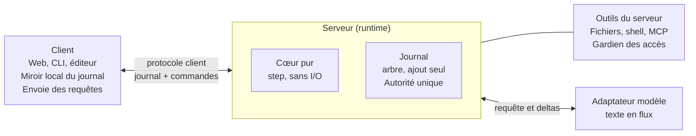

# Specs du Harness

## Objectifs et principes

Le Harness est l'ensemble de paquets du monorepo Wica qui permet à une personne de travailler avec un agent. Sa logique est pure et sans intégration : boucle d'agent, format de conversation, outils, et un protocole unique, entre un client (l'interface) et le serveur qui réunit la boucle, l'exécution des outils et les appels au modèle. Le chat est une interface construite par-dessus : la page Specs du chat s'appuie sur celle-ci et ne décrit que ce qui lui est propre (base de données, synchro, identité, rendu, déploiement).

Objectifs :

- Un cœur sans I/O : `step(état, événement)` rend un nouvel état et des intentions, et c'est l'hôte qui exécute les intentions.
- Ajouter un outil est facile et agréable : un nom, une description, un schéma, une fonction.
- Une boucle d'agent en quelques lignes (`createHarness`), avec des callbacks pour l'autorisation et l'affichage.
- Deux canaux d'outils bien distincts : agir sur l'environnement, et s'adresser à l'utilisateur.
- MCP et Skills supportés : le cœur ne va rien chercher lui-même ; le paquet `mcp` gère les connexions MCP, et l'hôte fournit les skills. Les réponses de la personne se rendent comme sa parole, pas comme un résultat d'outil (voir Paroles de la personne dans les résultats d'outils).
- Conversation stockée en JSON, avec formatage des discussions et interprétation des appels d'outils.
- Deux extrémités : un client (web, CLI, éditeur) et un serveur. Le serveur est un paquet avec ses callbacks : il s'embarque dans une application ou tourne dans un binaire local, sur la machine de la personne ou dans un bac à sable.
- Un serveur qui ne garde aucun état entre deux requêtes (décision du projet) : l'état se reconstruit depuis le journal, ce qui permet un déploiement serverless ; une session persistée par l'hôte évite de tout renégocier à chaque message (voir Exécution sans état et sessions).

Principes :

- Les dépendances pointent vers le cœur, qui n'importe que des types.
- API web standard partout (`fetch`, `WebSocket`, `AbortSignal`, `crypto`), sauf dans les paquets qui touchent le système.
- Un seul grand monorepo (Wica) pour le Harness et les applications, sans publication pour l'instant ; les applications dépendent des paquets du Harness, jamais l'inverse, et les frontières entre dossiers sont vérifiées automatiquement.
- Le journal est la vérité : tout ce que voit le client passe par lui.
- Le journal n'appartient qu'au serveur (décision du projet) : le serveur le persiste comme il veut, ou le garde en mémoire. Le client reçoit des données et peut en garder un miroir local qui rattrape le serveur, mais n'est jamais une source de vérité. C'est toujours le client qui demande et le serveur qui répond.
- Licence : AGPL-3.0-or-later, comme tout le monorepo ; les dépendances doivent avoir une licence compatible (voir la page Wica).

| Sujet | Décision |
| --- | --- |
| Langage | TypeScript |
| Texte libre du modèle | Politique configurable ; par défaut tout passe par l'outil utilisateur et le texte libre est une pensée privée |
| Schémas d'outils | Standard JSON Schema (Zod, Valibot ou ArkType au choix) |
| `authorize` sans configuration | Tout autorisé, choix assumé ; avertissement unique et préréglages à prévoir |
| Serveur | Un seul paquet : boucle, exécution des outils et appels au modèle ; il possède le journal ; plus de protocole d'environnement |
| Exécution | Décision du projet : serveur sans état, un tour par invocation, jeton de clôture, file de reprise, sessions persistées par l'hôte |
| Agents autonomes et canaux | Hypothèse : provenance et confiance dans le journal, événements externes, réveils décidés par l'agent et notés dans le journal, canaux = clients du protocole ; l'accès à distance (tunnel) est hors du Harness |
| Topologies de la V1 | Tout local, serveur embarqué dans une application, serveur distant (machine de la personne ou bac à sable cloud) |
| Adaptateur de modèle | Un seul au début, pour le modèle de l'utilisateur, servi par wic-serving en Open Responses |
| Concurrence et I/O de la coquille | Promesses et `AbortSignal` partout : Effect, employé dès l'étape 1, a été retiré à l'étape 4 parce qu'il ne tenait pas son premier critère (voir Effect dans la coquille) |
| Fournisseurs de modèles hébergés | Hypothèse : paquet d'adaptateur séparé `model-pi`, bâti sur pi-ai seul (jamais sur sa boucle d'agent), à côté d'autres adaptateurs ; abonnements autorisés, avec un avertissement unique |

## Frontière entre le Harness et les applications

Le Harness définit des interfaces et leur contrat, et fournit des versions en mémoire pour les tests ; une application fournit les implémentations qui touchent son infrastructure. Le Harness ne nomme ni base de données, ni couche de synchronisation, ni système d'identité : s'il doit en parler, c'est par une interface. Règle de lecture : une phrase qui nomme Postgres, Electric, une table ou un navigateur précis appartient à la page de l'application, à l'exception des exemples du tableau ci-dessous.

| Responsabilité | Défini par le Harness | Fourni par l'application (exemple : le chat) |
| --- | --- | --- |
| Persistance du journal | `Store` : `claim`, `append(items, epoch)`, version en mémoire | Postgres |
| Réveil d'une conversation | `Scheduler` | File de la plateforme ou table |
| Sessions | `SessionStore` | Table `sessions` |
| Identifiants de modèle | `CredentialStore` | Table chiffrée `model_credentials` |
| Commandes d'un serveur distant | `CommandInbox` | Shape Electric sur `commands` |
| Lecture côté client | Protocole client et paquet `client` | Synchro Electric, TanStack DB, cache local |
| Identité et autorisation | `authorize`, `ClientAuth` et une identité opaque | `Principal`, comptes, organisations |
| Canaux de messagerie | `from`, `to` et le protocole client | Adaptateur d'une application de messagerie |
| Interface et avertissements | Callbacks (`onUserMessage`, `onFirstSubscriptionUse`) | Interface web |

## Architecture et topologies

Le cœur pur est au centre du serveur, qui réunit la boucle, l'exécution des outils et les appels au modèle. Le client lui parle par le protocole client, le seul protocole, ce qui permet de déplacer le serveur (application, binaire local, machine distante) sans toucher au client.



| Topologie | Où tourne le serveur | Client | Liaison |
| --- | --- | --- | --- |
| Tout local | Binaire local, avec accès au système de fichiers | Interface ou ligne de commande du même binaire | En mémoire ou stdio |
| Serveur embarqué | Dans une application hôte, qui fournit le `Store` et le transport | Navigateur ou autre client | Fourni par l'hôte |
| Serveur distant | Binaire sur la machine de la personne ou dans un bac à sable cloud | Navigateur ou autre client | Tout transport : WebSocket, boîte de commandes, tunnel (voir Transports et accès) |

Règles (décisions du projet, sauf mention) :

- Un seul serveur : boucle, exécution des outils et appels au modèle forment une seule pièce, un paquet avec ses callbacks (`Store`, `authorize`, outils, adaptateurs de modèle). Il s'embarque dans une application ou tourne dans un binaire local ; le serveur est ce que construit `createHarness`. Le mot environnement ne désigne plus qu'une chose, ce sur quoi les outils agissent (fichiers, shell), jamais un composant.
- Le journal n'appartient qu'au serveur. Le client en garde au plus un miroir local qui rattrape le serveur, jamais une source de vérité.
- Un seul protocole, le protocole client : le client demande et le serveur répond. Il n'y a plus de protocole d'environnement, de connexion inversée entre la boucle et les outils, ni de cache par `callId` pour des appels qui traversaient un réseau.
- Les outils tournent dans le processus du serveur. Si le processus s'arrête entre un appel d'outil et son résultat, l'appel reçoit un résultat d'erreur d'état inconnu et n'est jamais relancé (décision raisonnée, à confirmer par un essai).
- Le serveur n'exécute que les outils que l'hôte lui donne : un hôte multi-utilisateur ne lui donne pas d'outils système sur sa propre machine, ceux-là passent par un serveur distant (décision raisonnée, à confirmer ; le chat applique cette politique, voir sa page).
- Gardien des accès : le serveur déclare ce qu'il autorise (par exemple des dossiers racines) et le fait respecter indépendamment de `authorize`. Deux couches de défense, dans le même processus.
- Les appels au modèle partent du serveur, où qu'il vive, pour tous les fournisseurs, clés d'API comme abonnements. Les identifiants vivent là où vit le serveur, jamais dans le journal.
- Un client et un serveur se joignent par un `Transport` interchangeable, dont aucun choix n'appartient au cœur (voir la section Transports et accès). Un serveur sans état avance par tours courts (voir Exécution sans état et sessions).

## Le cœur : machine à états sans I/O

Le cœur est une fonction pure `step(état, événement)` qui rend un nouvel état et des intentions : il ne fait ni appel réseau, ni lecture de fichier, ni lecture d'horloge, tout passe par des événements entrants et des intentions sortantes. Le type s'appelle `Intent` pour ne pas se confondre avec la bibliothèque Effect (décision du projet).

```ts
type Event =
  | { t: 'user_message'; parentId: string | null; parts: Part[]; from?: Origin }
  | { t: 'model_delta'; delta: Delta }
  | { t: 'model_done'; message: AssistantMessage }
  | { t: 'model_failed'; error: string }   // échec du service de modèle après ses réessais
  | { t: 'tool_result'; callId: string; output: Part[]; isError?: boolean; from?: Origin }
  | { t: 'approval'; callId: string; granted: boolean }
  | { t: 'tools_changed'; tools: ToolSpec[] }
  | { t: 'persisted'; items: { id: string; seq: number }[] }   // accusé du Store
  | { t: 'external_event'; source: string; name: string; data: unknown; trust: Trust }
  | { t: 'wakeup_scheduled'; callId: string }   // appel autorisé de l'outil schedule
  | { t: 'wakeup_cancelled'; callId: string }   // appel autorisé de l'outil cancel_wakeup
  | { t: 'compacted'; from: string; to: string; summary: string }   // résumé rendu pour une requête summarize
  | { t: 'interrupt' }
  | { t: 'set_head'; itemId: string }
  | { t: 'approval_needed'; callId: string; question: string; to?: Destination }   // authorize a répondu { ask } ; to : l'approbateur désigné
  | { t: 'regenerate'; itemId: string; commandId: string }
  | { t: 'resume' }   // début d'un tour, ou fin d'une intention : travail en attente déduit du journal

type Intent =
  | { t: 'call_model'; request: ModelRequest }
  | { t: 'run_tool'; call: ToolCall }        // exécuté dans le serveur
  | { t: 'to_user'; item: Item }             // vers le client
  | { t: 'ask_user'; question: Question }
  | { t: 'persist'; items: ItemDraft[] }   // sans seq, attribué par le Store
  | { t: 'schedule'; at: string }   // réveiller la conversation à cette heure, par le Scheduler de l'hôte
  | { t: 'append_delta'; itemId: string; text: string }   // texte en flux, regroupé en lots par l'hôte
  | { t: 'settle'; item: ItemDraft }   // contenu final et status d'un élément produit en flux

function step(state: State, event: Event): { state: State; intents: Intent[] }
```

Règles :

- Même état et même événement donnent les mêmes intentions : le rejeu est déterministe. L'heure et les identifiants entrent par les événements ou par le contexte fourni.
- L'état se sérialise en JSON : journal, instantané des outils, politique, plus grand numéro `seq`.
- Numérotation (décision raisonnée, à confirmer par un essai) : le Store est seul à attribuer `seq`. L'intention `persist` porte des éléments sans `seq` ; l'accusé revient en événement `persisted`, et le cœur retient le plus grand numéro vu. Le rejeu reste déterministe puisque le numéro entre par un événement.
- Les intentions décrivent ce que l'hôte doit faire. L'hôte les exécute et renvoie le résultat sous forme d'événement.
- Le classement du texte libre (outil utilisateur ou texte direct) se fait au traitement de `model_done`, selon la politique configurée, et s'inscrit dans `audience`.
- Repli du texte libre (décision raisonnée, à confirmer par un essai) : si un tour s'achève sans aucun appel d'outil, le dernier texte libre est promu en `audience: 'user'` avec la marque `promoted` dans `meta`, pour qu'une réponse sans `say` ne reste pas invisible ; le texte qui précède des appels d'outils reste privé. Le classement est inscrit dans `audience`, le rejeu reste déterministe.
- Approbation : un appel d'outil peut produire une demande ; l'événement `approval` y répond.
- Approbation dans le journal (décision raisonnée, à confirmer par un essai) : `approval_needed` écrit un `tool_call` du canal utilisateur, outil `approve`, de `callId` `approve:<callId>`. Tant qu'il est sans réponse, l'appel d'origine n'est pas lancé. `approval` écrit sa réponse (`meta.granted`, `as: 'user'`). Ensuite, `resume` lance l'appel avec `approved: true`, ou lui donne un résultat d'erreur « refusé ». Un tour sans état retrouve ainsi l'attente et la décision dans le journal.
- Date des événements (décision raisonnée, à confirmer par un essai) : chaque événement porte `at`, l'heure fournie par l'hôte, qui devient le `at` des éléments qu'il produit.
- Reprise (décision du projet pour l'événement, mécanisme en décision raisonnée à confirmer par un essai) : l'hôte envoie `resume` au début de chaque tour et après chaque intention terminée, jamais pendant qu'une intention est en cours. Comme un tour ne commence qu'après une réclamation réussie, tout élément encore en `streaming` vient d'un tour perdu : `resume` le règle en `interrupted`. Puis il déduit du bout de la branche affichée le travail en attente : appel au modèle après un message ou après le dernier résultat d'outil d'une réponse, `run_tool` pour chaque appel d'outil du canal environnement sans résultat, `ask_user` pour chaque appel du canal utilisateur sans résultat, rien après une réponse finale.
- Outils perdus : l'hôte réclame chaque `run_tool` auprès du `Store` par son `callId` avant de l'exécuter ; un appel déjà réclamé par un tour perdu reçoit un résultat d'erreur d'état inconnu, sans relance. Les appels au modèle ne sont pas réclamés : l'identifiant déterministe de leurs éléments écarte les doublons, et le bail évite le travail en double.
- Interruption : `interrupt` ferme proprement. Les éléments en `streaming` passent en `interrupted` et chaque appel sans résultat reçoit un résultat d'erreur synthétique.
- Interruption, précisions (décision raisonnée, à confirmer par un essai) : le texte partiel déjà reçu est gardé (`payload` rempli, `status = interrupted`) car c'est ce que la personne a vu. Un `tool_call` aux arguments incomplets n'est jamais gardé comme appel exécutable : il est écarté et noté dans `meta`, ce qui préserve l'appariement. Les appels en attente d'une réponse humaine reçoivent aussi un résultat d'erreur synthétique, puisque l'interruption est un choix explicite (contrairement à un redémarrage, voir la boucle).
- Échec du modèle (décision raisonnée, à confirmer par un essai) : quand le service de modèle échoue après ses réessais, l'événement `model_failed` règle en `failed` les éléments encore en flux, en gardant le texte reçu. Le tour s'arrête et l'erreur part aux clients ; rien ne relance le modèle avant la prochaine commande ou le prochain réveil.
- Réveils et échéances (décision raisonnée, à confirmer par un essai) : `resume` décide depuis le journal et l'heure de l'événement, sans événement de réveil à part. Quand la conversation est au repos, il déclenche le réveil échu le plus ancien en écrivant `wakeup_fired`, puis appelle le modèle ; un réveil ne coupe donc jamais un travail en cours. Des occurrences manquées d'un réveil récurrent ne déclenchent qu'un réveil, le plus récent. L'identifiant de `wakeup_fired` ne dépend que du réveil et de son occurrence : un réveil livré deux fois ne se déclenche qu'une fois. Une approbation sans réponse à son échéance (`approvalTimeoutMs` de la politique) reçoit un refus marqué `expired`. Chaque heure encore attendue (prochain réveil, échéance) part en intention `schedule`.
- Compaction : une intention `call_model` avec une requête de résumé ; son résultat devient un événement `compacted` dans le journal, sans suppression.
- Compaction, mécanisme (décision raisonnée, à confirmer par un essai) : le seuil vient de la politique (`compaction.maxChars`, taille en caractères de la vue du modèle) ; sans seuil, rien n'est résumé. Avant un appel au modèle dont la vue dépasse le seuil, `resume` émet une requête `summarize` sans outils, qui couvre la racine jusqu'à l'élément qui précède l'échange en cours (la dernière entrée et sa suite) : aucun appel d'outil n'y est séparé de son résultat, et un résumé plus ancien entre dans le nouveau. Le serveur écrit le texte rendu en événement `compacted`, puis l'appel au modèle suit sur la vue résumée. Une plage n'est jamais résumée deux fois, même quand l'échange en cours dépasse seul le seuil. Un résumé vide arrête le tour avec une erreur plutôt que d'effacer le passé de la vue. `compactPath`, la vue compactée, vit dans `core`.
- Sous-agents (décision raisonnée, à confirmer à l'étape 2) : un sous-agent est un outil dont `run` ouvre une conversation enfant, au journal séparé portant `parent_call_id`. Pour le parent, c'est un seul `tool_call` et un seul `tool_result` (la sortie finale de l'enfant), donc aucun invariant du journal ne change, et l'enfant se rejoue seul.
- Sous-agents, limites : l'autorisation et les limites de l'enfant (étapes, durée) sont celles du parent ou plus étroites, jamais plus larges. `interrupt` du parent descend vers l'enfant par `AbortSignal`. La profondeur est bornée. Les capacités du serveur (fichiers, shell) sont partagées avec le parent sauf indication contraire de l'outil.
- Types à préciser : `Delta`, `AssistantMessage`, `ModelRequest`, `Question`, `ToolCall`.

## Journal de conversation

Une conversation est un journal plat, en ajout seul, d'éléments typés organisés en arbre par `parentId` ; c'est le format canonique du cœur, et il appartient au serveur : le client n'en garde qu'un miroir, et la persistance est celle de l'hôte.

```ts
type ItemStatus = 'streaming' | 'done' | 'interrupted' | 'failed'
type Item = { id: string; parentId: string | null; seq: number; at: string; status: ItemStatus; meta?: Meta } & (
  | { kind: 'user_message'; parts: Part[]; from?: Origin }
  | { kind: 'external_event'; source: string; name: string; data: unknown; trust: Trust }
  | { kind: 'assistant_text'; text: string; audience: 'user' | 'private'; to?: Destination }
  | { kind: 'reasoning'; text?: string; opaque?: { provider: string; data: unknown } }
  | { kind: 'tool_call'; callId: string; tool: string; input: unknown; channel: 'environment' | 'user'; to?: Destination }
  | { kind: 'tool_result'; callId: string; output: Part[]; isError?: boolean; as?: 'tool' | 'user'; from?: Origin }
  | { kind: 'event'; name: 'interrupted' | 'compacted' | 'approval' | 'tools_changed' | 'branch_resumed' | 'wakeup_scheduled' | 'wakeup_fired' | 'wakeup_cancelled' | 'regenerate' | 'handed'; data: unknown }
)
type Part =
  | { type: 'text'; text: string }
  | { type: 'file'; uri: string; mediaType: string; sha256: string }
type Trust = 'owner' | 'known' | 'untrusted'
type Origin = { channel: string; author?: string; trust: Trust }        // d'où vient une entrée
type Destination = { channel: string; recipient?: string }              // à qui s'adresse une sortie
type Wakeup = { id: string; at: string; every?: string; payload: unknown }
type Log = { schema: 1; items: Item[] }
```

Règles :

- Arbre : `parentId` est l'élément précédent de sa branche. Éditer un message ou régénérer une réponse crée un élément de même parent que l'original. La vue affichée est le chemin de la tête (`head`) jusqu'à la racine.
- Ajout seul : un élément n'est jamais effacé ni modifié, sauf la transition de `status` pendant son flux.
- `status` : un élément produit en flux naît en `streaming` et finit en `done`, `interrupted` ou `failed` ; tout autre élément naît en `done`.
- Identifiants (décision du projet) : tous les identifiants d'éléments sont déterministes, au format UUID v8 tiré d'un SHA-256, calculés par une fonction pure de `core` sans dépendance, la même chez le client et le serveur. Un `user_message` a pour identifiant le hachage du sel de la conversation, de la conversation, du parent, de la provenance (`from` : canal et auteur) et du contenu (`parts`) sérialisé de façon canonique (clés triées, encodage fixé ; un fichier y entre par son `sha256`). Deux envois identiques d'une même personne sous un même parent forment donc un seul élément, et deux personnes qui envoient le même texte restent distinctes.
- Identifiants des éléments du serveur (décision raisonnée, à confirmer par un essai) : un élément produit par le serveur est créé avant que son contenu existe ; son identifiant est le hachage de la conversation, du parent, de l'entrée qui a déclenché sa production (l'élément auquel il répond, ou la commande d'une régénération) et de son rang parmi les éléments produits pour cette entrée. Le rang ne se recompte jamais depuis le journal : un rejeu après une écriture réussie décalerait sinon le rang et dupliquerait l'élément.
- Sel de conversation (décision du projet) : chaque conversation porte une valeur aléatoire secrète, fournie par le `Store` et transmise aux clients autorisés, qui entre dans le hachage des `user_message`. Elle empêche de retrouver un message court en hachant des textes devinés.
- `seq` ordonne les frères et sert de curseur ; la structure vient de `parentId`.
- `audience` enregistre le classement du texte libre : le rejeu reste déterministe si la politique change.
- Les appels de l'outil utilisateur sont de vrais `tool_call` avec `channel: 'user'`, rejouables vers tout fournisseur ; l'interface les affiche à part.
- Invariant validé par le cœur : sur un chemin, chaque `tool_call` reçoit exactement un `tool_result` avant le prochain appel au modèle, sinon un résultat d'erreur synthétique est ajouté. Les fournisseurs rejettent les requêtes dont un appel d'outil n'a pas de résultat.
- Données opaques d'un fournisseur (signatures de réflexion, raisonnement chiffré) : conservées telles quelles, jamais renvoyées à un autre fournisseur.
- Compaction : un événement `compacted` remplace une plage dans la vue d'un chemin, sans rien supprimer ; les autres branches ne changent pas. Ses données portent les bornes de la plage (`from`, `to`) et le résumé (`summary`).
- Effacement (décision raisonnée, à confirmer par un essai) : l'ajout seul admet une seule exception, l'effacement d'une conversation entière, en cascade sur ses éléments, ses données de flux et ses blobs, avec une trace minimale (identifiant de la conversation et date). Le sel de la conversation est effacé avec elle, ce qui rend illisibles les identifiants d'éléments restés ailleurs (traces d'exploitation). Jamais d'effacement partiel d'un élément ou d'une branche, pour garder le journal rejouable. Cette exception répond au consentement prévu pour l'entraînement, qui doit pouvoir être retiré. Les blobs, adressés par `sha256`, sont libérés quand plus aucun élément ne les référence (ramasse-miettes par accessibilité).
- Gros résultats d'outils : référence vers un blob (`uri`, `sha256`) et aperçu tronqué.
- La vue pour l'écran est dérivée du journal, jamais stockée.
- Reprise d'une ancienne branche (décision raisonnée, à confirmer par un essai) : le journal est un enregistrement d'observations, pas d'état, et restaurer l'environnement n'est pas garanti. Quand une branche reprend alors que l'environnement a agi sur une autre branche depuis l'ancêtre commun, le cœur insère un événement `branch_resumed` (ancêtre commun et `callId` des outils qui ne sont pas en lecture seule) que le modèle voit et qui l'invite à ré-observer avant d'agir sur ce qu'il croit savoir. `resume` l'écrit juste avant l'appel au modèle : il retient les appels du canal environnement qui ont un résultat, qui sont hors du chemin affiché, dont l'outil n'est pas en lecture seule, et qu'aucun `branch_resumed` du chemin n'a déjà signalés. Les points de contrôle de l'environnement sont une capacité optionnelle `snapshot` du serveur, hors V1.

## Outils

Un outil est un nom, une description, un schéma d'entrée et une fonction : la déclaration, sérialisable, sert au cœur et à l'interface ; la fonction `run` ne sert qu'à l'hôte.

```ts
const readFile = defineTool({
  name: 'read_file',
  description: 'Lit un fichier texte.',
  input: z.object({ path: z.string().describe('Chemin relatif') }),
  annotations: { readOnlyHint: true },
  run: async ({ path }, ctx) => ctx.env.fs.read(path),
})

type ToolSpec = {
  name: string
  description: string
  inputSchema: JSONSchema            // même forme que MCP
  annotations?: { title?: string; readOnlyHint?: boolean; destructiveHint?: boolean;
                  idempotentHint?: boolean; openWorldHint?: boolean }
  channel: 'environment' | 'user'
  runsOn?: 'server' | 'client'          // 'client' : exécuté par un client, résultat renvoyé par answer
  speaker?: 'user'                      // résultat rendu comme parole de la personne ; réservé aux outils de canal enregistrés par l'hôte
}
```

Règles :

- Schéma : tout schéma conforme à [Standard JSON Schema](https://standardschema.dev/json-schema) (Zod, ArkType, Valibot via son convertisseur) ou du JSON Schema brut, par exemple pour les outils MCP. Les types de `run` sont inférés du schéma.
- Deux moitiés : `ToolSpec` (déclaration) et `run`. Un outil sans `run` est seulement déclaré et s'exécute ailleurs : navigateur, serveur MCP, serveur distant.
- Deux axes indépendants : le canal (`environment` pour agir, `user` pour parler à l'utilisateur) et le lieu d'exécution. Un outil du canal utilisateur s'exécute côté client, sauf s'il déclare `runsOn: 'server'` ; un outil exécuté côté client attend sa réponse par `answer`. `ask_user` s'exécute côté client. `say` s'exécute sur le serveur : le message est l'appel lui-même, et son résultat est un accusé, pour qu'un message ne bloque jamais la boucle.
- Outil de l'environnement exécuté par un client (fichiers et terminal d'un éditeur) : l'appel passe par `authorize` comme tout outil. Une fois autorisé, le serveur écrit un événement `handed` qui confie l'appel au client, puis attend son résultat. Le client répond par `answer` avec un `ClientToolResult { output, isError? }`. Un appel ne part donc jamais chez le client avant son autorisation.
- Annotations : le vocabulaire de MCP ([valeurs par défaut de la spec](https://www.speakeasy.com/docs/mcp/build/gram-functions/tool-annotations) : non lecture seule, destructif, non idempotent, monde ouvert), commun aux outils natifs et MCP. Il sert à `authorize` et au parallélisme.
- Contexte `ctx` : `env` (capacités), `signal` (`AbortSignal`), `callId`, `progress(msg)` vers le client (jamais vers le modèle), vue en lecture seule du chemin. Aucun global : chaque outil se teste avec un faux `ctx`.
- Validation : les arguments du modèle sont validés contre le schéma ; un échec devient un `tool_result` d'erreur renvoyé au modèle, jamais une exception.
- Annulation et délais passent par `signal`.
- Parallélisme : seuls les outils en lecture seule s'exécutent ensemble ; les résultats suivent l'ordre des appels. Le journal les garde dans leur ordre d'arrivée, et `codecs` les remet dans l'ordre des appels quand il rend la requête du modèle (décision raisonnée, à confirmer par un essai).
- Liste dynamique (MCP, modes) : un instantané par tour, enregistré par un événement `tools_changed` dans le journal, avec un ordre stable pour le cache de prompt des fournisseurs.
- Instantané des outils (décision raisonnée, à confirmer par un essai) : l'événement `tools_changed` reçu par le cœur déclare seulement les outils configurés. Juste avant un appel au modèle, `resume` compare ces outils au dernier instantané du chemin affiché et écrit un élément `tools_changed` portant la liste complète s'ils diffèrent. La décision ne dépend ainsi que du journal, et un tour qui reconstruit son état écrit les mêmes instantanés qu'un serveur qui le garde en mémoire.
- Les outils MCP sont préfixés par le nom de leur serveur ; les contraintes de nom des fournisseurs sont vérifiées dans les adaptateurs.
- Les arguments en cours d'écriture par le modèle sont exposés au client (état d'entrée partielle).

## Paroles de la personne dans les résultats d'outils (hypothèse)

Quand le modèle pose une question à la personne, sa réponse revient aujourd'hui comme le résultat d'un outil. Elle se lit alors comme une donnée et non comme une consigne : un modèle qui applique la prudence habituelle envers les résultats d'outils peut ignorer un « fais plutôt ceci ». Cette section permet à un outil du canal utilisateur de dire que son résultat est la parole de la personne.

Règles :

- Déclaration : le `tool_result` d'un outil du canal utilisateur porte `as: 'user'` et une provenance `from` (canal, auteur, confiance), renseignée par l'hôte ou le client qui répond, jamais par l'outil. Un seul élément reste dans le journal : le tour de la personne est dérivé au rendu, rien n'est dupliqué et l'appariement entre appel et résultat est intact.
- Rendu (`codecs`) : la plupart des API exigent un résultat pour chaque appel d'outil. Le rendu émet donc un résultat d'outil minimal (par exemple une confirmation de réception), puis un tour de la personne qui contient la réponse ; quand l'API accepte du texte à la suite des résultats d'outils dans le même tour utilisateur, les deux vont dans le même tour. Avec plusieurs appels en attente, tous les résultats d'outils viennent d'abord, dans l'ordre des appels, puis les tours de la personne, dans le même ordre. Le modèle maison passe par Open Responses (voir Adaptateur de modèle et format de chat) et suit la même règle.
- Capacité : chaque adaptateur de modèle déclare s'il accepte du texte après un résultat d'outil dans le même tour ; sinon deux tours consécutifs sont émis.
- Privilège : un outil ne peut pas se déclarer lui-même parole de la personne. Seuls comptent les outils de canal enregistrés par l'hôte (`speaker: 'user'` dans leur déclaration) et la réponse à une demande d'information d'un serveur MCP (elicitation), qui passe par le canal utilisateur. Le résultat de tout autre outil, MCP compris, reste un résultat d'outil, même s'il prétend le contraire : sinon un outil tiers pourrait donner des ordres avec l'autorité de la personne.
- Confiance : la confiance du tour dérivé est celle de `from`. Une réponse venue d'un canal `untrusted` ne vaut pas parole du propriétaire.
- Au-delà de la question : le même mécanisme sert à tout outil de canal dont le résultat est ce que dit la personne (lire le prochain message d'une messagerie, transcrire un message vocal, valider un formulaire).
- Paquet `tools-user` : il vit à côté et contient un bon outil de questions, `ask_user` (choix uniques ou multiples, texte libre, confirmation, formulaire à champs typés, aperçu d'une option), ainsi que `say` et le rendu de leurs réponses en parole de la personne. Le client s'appuie sur ses types pour afficher les questions. L'hôte passe ce rendu (`renderAnswer`) à `createHarness`, puisque `runtime` ne dépend pas de `tools-user`.

## Boucle et autorisation

Le cœur pur reste utilisable seul, et une boucle prête à l'emploi l'enveloppe : trois niveaux d'usage, du plus bas au plus simple.

1. `step` : le cœur pur, pour qui veut tout contrôler.
2. `createHarness` : le serveur : la boucle qui interprète les intentions, l'exécution des outils et les appels au modèle, avec les callbacks de l'hôte.
3. `harness.run(prompt)` : un flux d'événements, en une ligne.

```ts
const mcp = await connectMcp(serveurs)      // configuration de l'hôte
const harness = createHarness({
  model: monAdaptateurDeModele,
  tools: () => [readFile, bash, askUser, ...mcp.tools()],   // relue à chaque tour
  skills: skillsKit(await loadSkills(dossiers, lire), lire), // fournis par l'hôte
  authorize: async (call) =>
    call.annotations.readOnlyHint ? 'allow' : { ask: `Autoriser ${call.tool} ?` },
  onUserMessage: (m) => ui.show(m),
})

for await (const event of harness.run('Range ce dossier')) { /* ... */ }
```

Règles :

- `tools` est une liste, ou une fonction de la conversation relue à chaque tour : l'hôte y donne à chaque conversation les outils de son client, par exemple ceux d'un éditeur ACP.
- `authorize(call, ctx)` renvoie `'allow'`, `'deny'`, `{ deny: raison }` ou `{ ask: question }`. Une question passe par le canal utilisateur et la réponse revient en `approval`.
- Décision prise : sans `authorize`, tout est autorisé. Garde-fous prévus : un avertissement unique dans la console, et des préréglages exportés (`allowAll`, `readOnlyOnly`) pour que le mode choisi soit visible dans le code de l'hôte.
- Politique du texte libre : configurable. Par défaut, tout passe par l'outil utilisateur et le texte libre est une pensée privée (`audience: 'private'`). Un mode chat simple affiche le texte directement (`audience: 'user'`).
- Les callbacks de l'hôte (`authorize`, `onUserMessage`, traces avant et après chaque outil) sont les seuls points d'intégration ; la boucle n'a aucun comportement caché.
- Limites réglables : nombre d'étapes, durée totale, taille des résultats gardés dans le journal.
- Reprise après redémarrage (décision raisonnée, à confirmer par un essai) : le serveur n'a pas d'état propre, il se reconstruit depuis le journal. Comme aucun processus ne voit de démarrage en serverless, c'est le tour qui réclame une conversation dont le bail précédent a expiré qui fait passer en `interrupted` les éléments encore en `streaming`. Un appel d'outil resté sans résultat parce que le processus s'est arrêté pendant son exécution reçoit un résultat d'erreur d'état inconnu et n'est jamais relancé, puisque personne ne sait si son effet a eu lieu. Les appels du canal utilisateur (question, approbation) restent en attente : le modèle n'est pas appelé tant qu'ils n'ont pas de réponse, ce qui respecte l'invariant d'appariement, et un déploiement n'annule pas des questions que la personne n'a pas encore vues.
- Écrivain unique (décision raisonnée, à confirmer par un essai) : la correction repose sur un jeton de clôture : `claim(conversationId)` renvoie un `epoch` croissant et chaque `append(items, epoch)` est refusé si l'`epoch` est périmé ; un second écrivain échoue au lieu d'entrelacer des éléments (voir Exécution sans état et sessions). Le bail est court et sert à éviter le travail en double. Un verrou consultatif Postgres lié à la connexion est écarté pour le serverless (poolers en mode transaction, connexions éphémères). Le serveur est le seul écrivain, y compris pour les `user_message` reçus par commande ; toute instance peut réclamer la conversation, puisque les commandes passent par la boîte de commandes.
- Le Store (persistance du journal) est une interface facultative : le serveur décide de persister ou de garder le journal en mémoire ; il fournit une version en mémoire, et une application fournit la sienne (voir la page de l'application, par exemple celle du chat).

## Exécution sans état et sessions

Le serveur peut ne rien garder en mémoire entre deux requêtes, ce qui permet de le déployer en serverless : le cœur est pur, l'état se sérialise en JSON et se reconstruit depuis le journal, donc ce que le processus oublie, la base le garde. Le serveur sans état est une décision du projet, et le même code sert aussi un serveur qui reste allumé ; les mécanismes de cette section n'ont pas encore été essayés.

Un tour est l'unité de travail d'une invocation. Il réclame la conversation, charge le dernier instantané et les éléments depuis son `seq`, passe les événements en attente à `step`, exécute une intention, écrit, puis continue si le budget de temps le permet ou demande une reprise et s'arrête.

```ts
type Claim = { epoch: number } | { busyForMs: number }   // conversation tenue par un tour vivant
type Snapshot = { schema: 1; seq: number; items: Item[] }  // éléments réglés jusqu'à seq
interface Store {
  claim(conversationId: string, leaseMs: number): Promise<Claim>
  renew(conversationId: string, epoch: number): Promise<void>     // prolonge le bail
  release(conversationId: string, epoch: number): Promise<void>   // fin du tour
  load(conversationId: string, fromSeq: number): Promise<{ salt: string; head: string | null; items: Item[]; interruptRequested: boolean }>
  append(conversationId: string, items: ItemDraft[], epoch: number):
    Promise<{ persisted: { id: string; seq: number }[]; interruptRequested: boolean }>
  appendBatch(conversationId: string, itemId: string, idx: number, text: string, epoch: number): Promise<{ interruptRequested: boolean }>
  settle(conversationId: string, final: ItemDraft, epoch: number): Promise<void>   // contenu complet et status final, lots supprimés
  setHead(conversationId: string, itemId: string, epoch: number): Promise<void>
  requestInterrupt(conversationId: string): Promise<void>
  clearInterrupt(conversationId: string, epoch: number): Promise<void>   // la demande a été traitée
  claimToolCall(conversationId: string, callId: string, epoch: number): Promise<'claimed' | 'already_claimed'>
  loadSnapshot(conversationId: string): Promise<Snapshot | undefined>
  saveSnapshot(conversationId: string, snapshot: Snapshot, epoch: number): Promise<void>
}
```

Règles du tour :

- Réclamation : `claim(conversationId, leaseMs)` incrémente un `epoch` et pose un bail court sur la conversation ; chaque ajout au journal porte l'`epoch` et un tour périmé est refusé (jeton de clôture). C'est ce qui rend sûres les relances et les doubles livraisons des plateformes serverless, où deux invocations peuvent se chevaucher.
- Bail : tant qu'un tour tient un bail en cours, une autre réclamation rend le temps qui lui reste au lieu d'un `epoch`. Le tour prolonge son bail (`renew`) au tiers de sa durée et à chaque écriture, et le libère à la fin (`release`). Un processus figé perd son bail à l'échéance ; un autre reprend alors la conversation, et l'écriture suivante du processus figé est refusée. Un tour qui perd son bail s'arrête sans rien écrire ni signaler, car celui qui l'a remplacé poursuit.
- Réveil refusé : un réveil qui trouve la conversation tenue est replanifié à l'échéance du bail, pour qu'un processus mort ne laisse pas la conversation sans suite. Une commande qui la trouve tenue attend qu'elle se libère, au plus `commandWaitMs` (30 s par défaut), puis échoue.
- Budget : `turnBudgetMs` borne la durée d'un tour ; passé ce délai, le tour rend la main entre deux intentions et demande une reprise au `Scheduler`. Une commande se glisse ainsi entre deux tours.
- Confiance : un tour sans état retrouve la confiance de l'entrée qui l'a déclenché dans le journal, depuis le dernier message d'une personne ou événement externe du chemin.
- Interfaces fournies par l'hôte, déclarées dans `runtime` : `Store` (avec `claim`, `append(items, epoch)` et `appendBatch` pour les lots de deltas, qui indiquent aussi si une interruption est demandée, puis `settle` pour la fin du flux), `Scheduler` (réveiller une conversation, éventuellement après un délai ; le planificateur de l'hôte appelle `harness.wake(conversationId)` à chaque réveil, et sans planificateur fourni le Harness utilise celui du processus), `SessionStore`, `CredentialStore` (lire, rafraîchir sous exclusion mutuelle, révoquer), et `CommandInbox` (suivre les commandes d'un serveur depuis un curseur, les acquitter, recevoir son battement de cœur), déclarée dans `transport-inbox` car seul ce transport s'en sert. Le Harness en fournit des versions en mémoire pour les tests ; l'hôte fournit les siennes.
- `Store` distant : `resilientStore(store)` réessaie chaque opération pendant une coupure, avec une attente croissante et sans limite de durée (machine endormie, réseau perdu). Les écritures sont rejouables : clé primaire pour les éléments, index pour les lots, et réclamation d'outil idempotente pour un même `epoch`, faute de quoi une réponse perdue deviendrait une fausse erreur d'état inconnu. Un échec passager du renouvellement du bail n'arrête pas le tour ; seul un `epoch` périmé l'arrête.
- La requête n'attend jamais le modèle : une commande déclenche un tour court (réclamer, écrire l'élément reçu, accuser réception) puis demande une reprise ; l'appel au modèle et les outils longs s'exécutent dans des tours suivants.
- Au moins une fois : les identifiants d'éléments sont déterministes (voir Identifiants dans le journal), donc un rejeu retombe sur la même clé primaire et ne duplique rien. Les intentions à risque (outil, appel de modèle) sont réclamées avant d'être exécutés, une seule fois par `callId` ; une réclamation sans résultat après un délai donne l'erreur d'état inconnu, sans relance.
- Attente : une question ou une approbation en attente est un état où aucun tour n'est planifié ; la réponse arrive comme commande et déclenche un tour.
- Interruption : un drapeau que le `Store` conserve et renvoie à chaque écriture d'un lot de deltas ; le tour en cours s'arrête au lot suivant.
- Instantanés : un instantané JSON de l'état est écrit de temps en temps pour ne pas rejouer depuis le début ; il est dérivé du journal et jetable. Il contient les éléments jusqu'au premier élément encore en flux, exclu : un tour suivant peut encore régler celui-ci, alors que rien d'un instantané ne change plus. Un tour charge l'instantané, puis les éléments dont le `seq` le dépasse, et en écrit un nouveau quand `snapshotEvery` éléments (100 par défaut) se sont ajoutés.
- Prompt : `codecs` rend le prompt de façon déterministe, donc le préfixe reste identique d'un tour à l'autre et le cache de prompt des fournisseurs peut jouer (selon eux). Aucun état n'est gardé côté fournisseur (par exemple des réponses chaînées par identifiant) : cela casserait le journal canonique et le changement de fournisseur.
- Jetons OAuth : le rafraîchissement d'un abonnement passe par `CredentialStore`, qui l'exécute sous exclusion mutuelle pour que deux tours simultanés ne s'invalident pas. `refresh(key, stale)` reçoit le jeton refusé : si un autre tour l'a déjà remplacé, le nouveau est rendu sans second rafraîchissement. Un serveur MCP qui refuse un jeton (`401`) fait rafraîchir celui-ci une fois, puis la requête est rejouée.
- Question d'un outil en cours (demande d'information MCP) : la réponse doit arriver au processus qui exécute l'outil, car l'appel MCP attend dans sa mémoire. Sur un autre processus, la commande attend la libération de la conversation et échoue à son délai ; un hôte serverless garde donc l'invocation qui exécute un tel outil jusqu'à la réponse.
- Limites : un flux plus long que la durée maximale de la plateforme est coupé et l'élément passe en `interrupted` ; un nouvel essai crée un nouvel élément. Restent forcément avec état : le stockage et le transport de synchro de l'hôte, les serveurs distants avec leurs fichiers, et le flux du modèle pendant un tour.

Une session est la liaison logique d'un client avec un serveur, plus courte qu'une conversation. Elle porte ce qu'il serait coûteux de renégocier à chaque message, et chaque côté en garde une trace pour n'échanger que ce qui s'ajoute.

Règles de la session :

- Côté client : l'identifiant de session, ses curseurs de synchro (un par flux suivi) et l'identifiant de la dernière commande envoyée, gardés avec le cache local.
- Côté serveur : un enregistrement du `SessionStore` avec l'identité résolue par l'hôte (opaque pour le Harness), sa provenance et son échéance, plus le dernier `clientSeq` traité par conversation. Le client présente son `sessionId` dans `hello` : une session encore valide est reprise sans nouvelle authentification et son échéance est prolongée (`sessionTtlMs`, 24 h par défaut) ; sinon le serveur authentifie le jeton et ouvre une nouvelle session, et `welcome` dit laquelle des deux (`resumed`).
- Commande rejouée : une enveloppe dont le `clientSeq` ne dépasse pas le dernier traité pour sa conversation est accusée sans agir. Le `clientSeq` est propre à chaque client ; comme plusieurs clients partagent une connexion par une boîte de commandes, le dernier traité est gardé par session du serveur et session du client (`sessionId` de l'enveloppe). Cela protège surtout `interrupt`, qui sans cela pourrait arrêter un tour plus récent ; les autres commandes retombent aussi sur des identifiants déterministes.
- Ce que la session ne garde pas : la liste d'outils, car `tools_changed` n'est écrit que si l'instantané diffère du journal, et les identifiants de sessions MCP, car la révision 2026-07-28 de MCP n'a plus de session et la réutilisation en 2025-11-25 reste à mesurer.
- Ce qui circule : le client envoie `{ sessionId, commandId, clientSeq, command }` et rien d'autre, le serveur renvoie un accusé minimal ; les éléments nouveaux arrivent par l'abonnement, après l'offset du client. Rien ne renvoie l'historique, ni vers le client ni vers le serveur.
- Une session est un cache, jamais une vérité : sa perte ou son expiration coûte une renégociation, jamais une donnée. Le client en rouvre une sans que la personne le voie.
- Déconnexion : les sessions de la personne sont supprimées.

## Agents autonomes et canaux (hypothèse)

Le même Harness sert un agent qui attend une personne et un agent qui tourne seul, se donne des réveils et parle dans les applications de la personne (messagerie, chat, éditeur). Cette section ne définit pas de nouveau protocole : elle généralise le vocabulaire du journal, pour que ces usages tiennent sans changer de schéma. Le chat n'est qu'un client parmi d'autres.

Règles :

- Provenance (décision du projet) : un `user_message` est le message d'une personne, pas forcément du propriétaire. Il porte `from` : le canal par lequel il est arrivé, l'auteur et un niveau de confiance (`owner`, `known`, `untrusted`). Absent, il vaut `owner` sur le canal par défaut.
- Événements externes : un `external_event` est une entrée qui n'est pas le message d'une personne (minuteur, webhook, changement de fichier). Il porte sa source, un nom, des données et un niveau de confiance. L'hôte le transmet par `harness.external(conversationId, événement)`, qui l'écrit puis réveille la conversation. Une livraison répétée du même événement sous le même parent ne forme qu'un élément.
- Confiance : le niveau de l'entrée qui a déclenché le tour est passé à `authorize` dans `ctx`. Les résultats d'outils marqués `openWorldHint` (web, courrier) sont notés `untrusted` dans `meta` et ne se mélangent pas aux instructions du propriétaire. Une entrée non fiable ne déclenche un outil destructif qu'avec une approbation, même quand `authorize` l'autorise : le serveur change alors la décision en demande d'approbation.
- Canaux : un canal est un client qui reçoit les éléments qui lui sont adressés et envoie des commandes : interface web, ligne de commande, éditeur, application de messagerie. Ce n'est pas un concept de protocole en plus, c'est un client du protocole client. L'hôte enregistre ses canaux avec leurs capacités (texte, fichiers, boutons d'approbation).
- Destinataire : les sorties du canal utilisateur (`assistant_text` d'audience `user`, `say`, `ask_user`) peuvent porter `to`. Sans `to`, la réponse part là où le dernier message est arrivé (`from`) ; une demande d'approbation part vers l'approbateur désigné de la conversation, qui peut être un autre canal que celui d'où vient l'entrée. L'hôte désigne l'approbateur par l'option `approver(conversationId)` ; la demande porte alors `to`, et le serveur refuse la réponse de tout autre canal ou auteur.
- Réveils : l'outil intégré `schedule` (une date `at` ou un délai `inSeconds`, une récurrence `every` en durée ISO 8601 de jours, heures, minutes et secondes, une charge utile `payload`) crée un réveil, noté `wakeup_scheduled` dans le journal, déclenché par le `Scheduler` puis noté `wakeup_fired` ; `cancel_wakeup` l'annule. Le cœur ne lit jamais l'horloge : il reçoit l'heure par les événements, et `resume` déclenche le réveil échu d'après le journal, donc le rejeu reste déterministe. `schedule` et `cancel_wakeup` sont fournis par `runtime` (`scheduleTools`), `say` et `ask_user` par `tools-user`.
- Rendu d'un réveil : le modèle reçoit la charge utile comme une entrée, jamais avec l'autorité des consignes, puisqu'il l'a écrite lui-même, parfois après une entrée non fiable.
- Garde-fous sans humain : un budget par réveil (étapes, durée, coût), un plafond de réveils par période, un délai au-delà duquel une approbation sans réponse vaut refus, et une pause automatique quand une boucle de réveils ne produit rien de nouveau. Les valeurs sont réglées par l'hôte, rien n'est caché.
- Garde-fous, mécanisme (décision raisonnée, à confirmer par un essai) : ils vivent dans la politique du cœur (`approvalTimeoutMs`, `wakeups`). Le budget d'un réveil compte les appels au modèle et la durée depuis `wakeup_fired` ; épuisé, la réponse s'arrête par un événement `interrupted` de raison `wakeup_budget`. Le coût n'est pas encore mesuré, faute de consommation notée dans le journal. Au-delà du plafond par période (24 h par défaut), le réveil attend que le plus ancien de la période en sorte. Une réponse à un réveil apporte du nouveau quand elle appelle un outil de l'environnement qui n'est pas en lecture seule, ou quand ce qu'elle montre ou demande à une personne diffère de la réponse au réveil précédent ; après trois réveils de suite sans rien de nouveau (réglable), les réveils se taisent jusqu'au prochain message d'une personne ou événement externe.
- Autorisation sans personne : `authorize` reçoit la confiance de la source et sait si un client est attaché. Un préréglage `unattended` refuse ce qui est destructif ou à monde ouvert sans approbation préalable de l'approbateur désigné : il demande cette approbation, et avec `approvalTimeoutMs` le silence vaut refus. Les annotations absentes prennent les valeurs par défaut de MCP, donc un outil sans annotation demande l'approbation.
- Outils côté client : un outil qui déclare `runsOn: 'client'` (téléphone, éditeur, navigateur) produit un `tool_call` adressé à un canal ; le client l'exécute et renvoie le résultat par `answer`. Sans client attaché, l'appel échoue après un délai avec une erreur dédiée plutôt que d'attendre sans fin. Le délai (`clientToolTimeoutMs`) court depuis la remise de l'appel au client et ne s'applique que tant qu'aucun client n'est attaché ; le départ du dernier client réveille la conversation pour que l'échéance compte.
- Authentification des clients : le serveur expose son point d'entrée derrière une interface `ClientAuth` (qui est ce client, a-t-il le droit de lire et d'écrire cette conversation), fournie par l'hôte ; l'identité renvoyée est opaque pour le Harness. Pour un serveur seul sur une machine, un jeton d'appairage suffit.
- Notification : un callback d'hôte `onAttentionNeeded` signale qu'une approbation, une question ou une fin de tâche attend, ce qui permet une notification sur un téléphone. Il part à la fin du tour qui a écrit la question, avec son destinataire, et à la fin d'un tour qui a travaillé sans rien laisser en attente.
- Accès à distance : joindre un serveur derrière un routeur n'est pas l'affaire du Harness, qui ne sert que la liaison WebSocket directe. Un tunnel (un petit paquet séparé autour de WireGuard, prévu hors de ce dépôt) fournit le reste.
- Plusieurs serveurs pour une personne (hypothèse) : une conversation appartient à un serveur à la fois. Passer de l'un à l'autre est un transfert du journal et du sel de la conversation, portable en JSON, avec une nouvelle réclamation (`epoch`) côté destination ; pas de synchronisation continue entre serveurs en V1.

## Skills et MCP

Le cœur ne découvre ni skills ni serveurs MCP et ne parle pas MCP. Les skills sont fournis par l'hôte sous forme de descripteurs ; les connexions MCP sont gérées par le paquet `mcp`, l'hôte ne donnant que la configuration (quels serveurs, avec quelles identités).

Skills ([format ouvert Agent Skills](https://agentskills.io/specification)) :

- Un skill est un dossier avec un `SKILL.md` (en-tête YAML avec au moins `name` et `description`, puis les instructions), plus des dossiers optionnels pour scripts, références et ressources.
- Divulgation progressive : au démarrage, le cœur ne reçoit que le nom et la description de chaque skill ; le `SKILL.md` complet est chargé quand la tâche correspond ; les fichiers liés le sont à la demande.
- L'hôte passe une liste de descripteurs ; la lecture des fichiers se fait par un outil du serveur. Un petit paquet `skills` fait l'analyse du `SKILL.md`.
- Le paquet `skills` ne touche pas au système de fichiers : l'hôte lui donne les emplacements des dossiers et une fonction de lecture. `loadSkills` lit les en-têtes et rejette un skill invalide au démarrage, par exemple un `name` qui n'est pas le nom de son dossier. `skillsKit` rend les consignes (nom et description de chaque skill) et l'outil `load_skill`, qui lit le corps du `SKILL.md` ou un fichier du dossier du skill, sans chemin qui en sorte.

MCP :

- Un adaptateur `mcp` transforme les outils d'un serveur MCP en `ToolSpec` plus `run`, et inversement. Le cœur ne parle pas MCP.
- Le protocole MCP évolue vite : garder MCP hors du cœur permet de changer d'adaptateur sans toucher au reste. Le SDK officiel en version 2 le confirme : la révision 2026-07-28 n'a plus de poignée de main `initialize` (le serveur annonce ses versions par `server/discover` et chaque requête porte ses métadonnées), et une demande d'information y revient dans la réponse de l'appel d'outil (`input_required`) au lieu d'une requête du serveur. Le paquet `mcp` utilise ce SDK (`@modelcontextprotocol/client`, Apache-2.0) en négociation automatique : il parle les deux révisions.
- Connexion (décision du projet) : le paquet `mcp` initialise la connexion à chaque serveur configuré, négocie la version du protocole et les capacités, et expose les outils d'un serveur comme des `ToolSpec` avec leur `run`. Il se reconnecte après une coupure et ne laisse jamais une connexion cassée faire échouer un tour : l'outil concerné renvoie un résultat d'erreur.
- Sans état : la liste d'outils d'un serveur et l'identifiant de session MCP, quand le serveur en fournit un, sont gardés dans la session (`SessionStore`) pour qu'un tour n'ait pas à tout renégocier ; une session perdue coûte une nouvelle initialisation (voir Exécution sans état et sessions). La réutilisation d'une session MCP dépend du transport et du serveur : à vérifier.
- Authentification : les identifiants d'un serveur MCP viennent du `CredentialStore`, jamais de la configuration ni du journal ; le rafraîchissement suit la règle des jetons OAuth.
- Configuration : l'hôte passe une liste de serveurs (adresse, transport, identité à utiliser, outils autorisés ou refusés). Rien n'est découvert tout seul.
- Les demandes d'informations d'un serveur MCP (elicitation) sont acheminées vers le canal utilisateur. Pendant l'appel, l'outil MCP pose la question par `ask` de son contexte : le journal reçoit un `tool_call` du canal utilisateur nommé `elicit`, et la réponse de la personne (accepter avec des valeurs, refuser, annuler) revient au serveur et compte comme sa parole. Avec la révision 2025-11-25, la demande n'indique pas l'appel qui l'a causée : si plusieurs appels au même serveur tournent en parallèle, la question est rattachée au plus récent ; sans appel en cours, elle est refusée.
- Les annotations d'outils MCP alimentent directement `authorize`.
- Un changement de liste d'outils côté serveur devient un événement `tools_changed` : la liste notifiée par le serveur est relue au tour suivant, et le cœur n'écrit l'événement que si l'instantané diffère.
- Noms et annotations : un outil MCP s'appelle `<serveur>__<outil>`. Les annotations absentes prennent les valeurs par défaut de MCP, sauf qu'un outil en lecture seule n'est jamais destructif, car MCP ne donne un sens à `destructiveHint` que pour un outil qui écrit.
- Coupures : un appel trouve la connexion fermée, il la rouvre ; si elle tombe pendant l'appel, le résultat est une erreur sans relance, car l'effet a peut-être eu lieu. Un serveur injoignable ne bloque pas les autres ; chaque lecture de la liste d'outils relance sa connexion en arrière-plan.

## Transports et accès (hypothèse)

Comment un client et un serveur se joignent n'appartient pas au cœur du Harness : le même serveur peut être servi dans le même binaire que son client, par un processus local, par un serveur toujours allumé derrière un proxy, ou par un tunnel vers une machine derrière un routeur. Il n'y a pas de protocole d'environnement : les outils s'exécutent dans le processus du serveur. Cette section décrit l'interface qui rend cela possible et ce qu'elle exige. Hypothèse de travail, à confirmer par un essai.

Règles :

- Le client demande, le serveur répond : le serveur n'a aucune initiative vers le client en dehors du flux d'abonnement (éléments et deltas).
- Un transport est un canal de trames entre un client et un serveur : `send(trame)`, un flux `receive` de trames, `close`. Le Harness ne connaît que cette interface (`Transport`, déclarée dans `protocol`) ; la façon dont les deux se joignent n'en fait pas partie, et les paquets `transport-*` sont des adaptateurs interchangeables.
- Ce qu'on exige d'un transport est minimal : livrer des trames au moins une fois, sans garantie d'ordre entre deux connexions. Le protocole tient le reste : les commandes sont idempotentes par `commandId`, leur ordre est porté par `clientSeq` dans la trame et non par le transport, et la lecture reprend par curseur. Un transport peut donc couper, dupliquer ou rejouer sans rien corrompre, et n'importe lequel peut servir le même serveur.
- Adaptateurs prévus : `transport-memory` (client et serveur dans le même binaire, en mémoire), `transport-stdio` (processus local), `transport-ws` (WebSocket JSON vers un serveur joignable) et `transport-inbox` (hypothèse : transport à stockage intermédiaire, où l'hôte dépose les commandes dans une `CommandInbox` que le serveur suit par une connexion sortante, et où le serveur écrit ses éléments par un `Store` distant avec le même jeton de clôture qu'un serveur embarqué ; il traverse un routeur sans rien d'entrant). Un hôte peut en fournir d'autres sans toucher au Harness.
- `transport-inbox` présente la boîte comme un transport de serveur : `harness.serve(inboxTransport(boîte, { token }))`. Il ouvre la connexion par un `hello` portant le jeton du serveur, livre chaque commande telle quelle, rend chaque accusé à la boîte (réessayé, sinon la commande resterait en attente chez l'hôte) et envoie un battement de cœur. Les éléments ne passent pas par lui : le serveur les écrit par le `Store` de l'hôte, et les clients les lisent par la synchro de l'hôte. Après une coupure, il relit la boîte depuis le dernier curseur reçu ; au redémarrage du processus, il repart des commandes sans accusé, et une commande rejouée retombe sur ses identifiants déterministes.
- Accès : rendre un serveur joignable est du déploiement, pas du Harness. Même binaire pour le client et le serveur, serveur toujours allumé derrière un proxy, tunnel (WireGuard, Cloudflare Tunnel) pour une machine derrière un routeur : le Harness ne distingue pas ces cas, il voit un `Transport`. Un tunnel auto-hébergé est un paquet séparé, hors de ce dépôt. Pour le client, serveur embarqué et serveur distant sont indiscernables : l'hôte associe chaque conversation à un serveur et reste sans état.
- Authentification du serveur : un jeton par serveur, révocable, avec ses permissions déclarées. Un bac à sable cloud démarre avec une URL et un jeton, puis se connecte comme n'importe quel serveur distant.
- Reprise : le client reprend à son curseur de synchro (avec `transport-inbox`, le serveur reprend aussi à son curseur sur la boîte) ; les commandes portent un identifiant généré par le client, ce qui rend leur rejeu sans doublon.
- Serveur injoignable : avec un transport à stockage intermédiaire, les commandes restent en attente ; un battement de cœur (`last_seen_at` du serveur) permet au client d'afficher « serveur hors ligne » et de laisser la personne attendre ou renoncer. Le miroir local reste lisible.
- Une coupure de la connexion sortante n'arrête pas l'outil en cours : le serveur le termine et écrit son résultat à la reconnexion (écritures rejouables par clé primaire).
- Annulation : `interrupt` est une commande comme les autres ; le serveur propage un `AbortSignal` à l'outil en cours et à la requête de modèle.
- Gros résultats : un blob adressé par `sha256`, récupéré hors du flux sur une URL servie par le serveur.
- Version : un numéro de protocole à la connexion, les champs inconnus sont ignorés.
- Identifiants du modèle : la machine qui héberge le serveur exécute aussi le shell de l'agent, qui pourrait lire des identifiants (injection de prompt). Le magasin d'identifiants reste hors des racines autorisées et, idéalement, l'hôte de modèle tourne dans un autre processus que l'exécuteur d'outils. Dans un bac à sable cloud, y mettre l'abonnement d'une personne l'expose au shell de l'agent : à décider avant l'étape du serveur distant (processus séparé, jetons de courte durée ou clé d'API dédiée).

## Protocole client

Le protocole client est le journal lui-même plus un petit jeu de commandes : le client lit un flux reprenable d'éléments et envoie des commandes, et le serveur répond. Le journal n'appartient qu'au serveur : le client en garde au plus un miroir local qui rattrape, jamais une source de vérité.

```ts
type Subscribe = { conversationId: string; fromSeq: number }   // lecture reprenable
type Envelope = { sessionId: string; commandId: string; clientSeq: number; conversationId: string; command: Command }   // commandId : rejeu sans doublon ; clientSeq : ordre des commandes d'un client
type Frame = Envelope | ServerFrame   // ServerFrame : éléments, deltas, accusés
interface Transport { send(f: Frame): Promise<void>; receive(): AsyncIterable<Frame>; close(): Promise<void> }
type Command =
  | { t: 'send'; parentId: string | null; parts: Part[] }
  | { t: 'answer'; callId: string; value: unknown }   // question, approbation ou résultat d'un outil exécuté par le client
  | { t: 'interrupt' }
  | { t: 'set_head'; itemId: string }
  | { t: 'regenerate'; itemId: string }   // autre réponse à cet élément, sur une nouvelle branche
```

Règles :

- Lecture : le flux d'éléments et de deltas, reprenable depuis un `seq`. L'abonnement transmet aussi le sel de la conversation, pour que le client calcule l'identifiant de son message avant l'envoi ; le serveur le recalcule de son côté avec la même fonction. Sur le web, le transport est fourni par l'application (voir la page de l'application, par exemple celle du chat) ; en local, le même flux passe par stdio ou WebSocket.
- Écriture : les commandes. Un `ask_user` ou une demande d'approbation est un `tool_call` du canal utilisateur, et la réponse est un `tool_result` produit par `answer`. Aucun mécanisme à part : la réponse porte `as: 'user'` et sa provenance, et se rend comme parole de la personne (voir Paroles de la personne dans les résultats d'outils).
- Un `set_head` change la branche affichée ; les autres branches restent dans le journal.
- Régénération (décision raisonnée, à confirmer par un essai) : `regenerate` écrit sous l'élément visé un élément `event` de nom `regenerate`, qui porte le `commandId`. La nouvelle réponse en est l'enfant : c'est une branche sœur de l'ancienne, et le `commandId` rend ses identifiants distincts.
- Reprise côté client (décision raisonnée, à confirmer par un essai) : un élément réglé après coup garde son `seq`. Le client reprend donc la lecture avant le plus ancien élément qu'il garde encore en `streaming`, et sinon après le plus grand `seq` reçu.
- Enveloppe : elle porte la conversation visée (`conversationId`), puisqu'une session sert plusieurs conversations.
- Enveloppe et session : chaque commande voyage dans une enveloppe `{ sessionId, commandId, clientSeq, command }`, et le client se connecte par un `Transport` : les mêmes trames, quel que soit l'adaptateur ; le détail de la session est dans Exécution sans état et sessions.
- Connexion : `hello { version, token?, sessionId? }` ouvre ou reprend une session, et `welcome { version, sessionId, resumed }` répond. Après une reconnexion, le client présente sa session connue ; perdue côté serveur, il en reçoit une autre sans que la personne le voie.
- Trames de service : `ping` reçoit `pong`, ce qui révèle une connexion morte ; `status { conversationId, running }` dit si un tour tourne, envoyé à l'abonnement puis à chaque changement ; `error` porte la conversation quand il la concerne, et sans conversation il refuse la connexion elle-même.
- La vue pour l'écran (messages, états des outils, branche active) est dérivée côté client par un paquet `client`, sans état propre.
- La vue expose aussi les appels confiés à ce client (`clientCalls`) et le repos du journal (`settled`) : aucun appel du chemin n'attend son résultat et rien n'attend de réponse du modèle. Avec `running` faux, `settled` dit que le serveur ne doit plus rien à la conversation. `running` seul ne le dit pas : entre deux tours d'un même message, après un résultat d'outil ou une approbation, il est faux alors que le journal attend sa suite. Le cœur exporte la même règle, celle qui décide si une reprise a du travail.
- `subscribe` se termine quand le miroir a rattrapé le serveur, à la première trame `status`.
- Le paquet `client` ne dépend d'aucune bibliothèque de synchronisation, de stockage ou de rendu propre à une plateforme (décision du projet). Chaque application fournit les siennes : l'application web du chat utilise TanStack DB et un cache SQLite, une application mobile ou de bureau réutilise les mêmes paquets TypeScript avec sa propre synchro.
- Adaptateur ACP : l'[Agent Client Protocol](https://agentic-ai.readthedocs.io/en/latest/Standards/agent-client-protocol/) (JSON-RPC bidirectionnel, standard ouvert pour relier éditeurs et agents) s'ajoute comme adaptateur. Dans ce cas, l'éditeur est à la fois le client et un fournisseur de capacités : il expose ses fichiers et son terminal, que le serveur utilise comme outils. Le support des agents distants y est encore en chantier selon une source tierce.
- Forme de l'adaptateur (paquet `acp`) : un agent ACP au-dessus d'un `Client` du protocole client, comme la ligne de commande. Une session ACP est une conversation, de même identifiant. `session/load` rejoue la conversation à l'éditeur, puis la session reprend.
- Message de l'éditeur : `session/prompt` envoie le message et se termine quand le serveur ne doit plus rien (`settled`, `running` faux), avec `end_turn`, ou `cancelled` après un `session/cancel`, qui envoie `interrupt`. Une erreur du tour devient une erreur JSON-RPC.
- Flux vers l'éditeur : le texte affiché et les `say` partent en `agent_message_chunk`, les outils en `tool_call` puis `tool_call_update` (`running` devient `in_progress`, `awaiting_approval` devient `pending`, `done` devient `completed`, `error` devient `failed`). Une demande à l'éditeur ne part qu'après les notifications qui la précèdent, pour qu'il connaisse déjà l'appel dont elle parle.
- Questions : une approbation devient `session/request_permission` (autoriser une fois, refuser une fois). Pour `ask_user`, une confirmation passe aussi par une permission ; les autres questions passent par un formulaire `elicitation/create` quand l'éditeur en annonce la capacité, un choix unique se rabat sur une permission, et sinon la réponse dit que l'éditeur ne peut pas répondre. Une demande d'un serveur MCP passe par l'elicitation de l'éditeur, ou reçoit un refus.
- Outils de l'éditeur : `editorTools` déclare `read_text_file`, `write_text_file` et `run_command` en `runsOn: 'client'`, d'après les capacités annoncées à `initialize`. L'hôte les donne à la conversation au moment où `onSession` signale la session, avec les serveurs MCP que l'éditeur y passe. Les chemins relatifs partent du dossier de travail de la session.
- Pas de protocole universel à concevoir d'abord : un protocole client par transport (transport d'application pour le web, flux local, WebSocket direct, boîte de commandes, ACP) qui expriment les mêmes commandes.

## Découpage en dossiers du monorepo

Les paquets du Harness vivent dans le monorepo Wica, un dossier par paquet, sans publication pour l'instant ; les applications, dont le chat, sont des dossiers à part qui dépendent d'eux. La discipline des dépendances est vérifiée automatiquement.

| Paquet | Contenu | Dépend de |
| --- | --- | --- |
| `core` | Types du journal, arbre, `step`, invariants, `ToolSpec`, intentions et événements, calcul déterministe des identifiants | rien |
| `codecs` | Chemin actif vers formats d'API de modèle (Open Responses) et flux de réponse vers `Delta` | core |
| `protocol` | Commandes et abonnements client, enveloppe de session, interface `Transport`, version | core |
| `runtime` | `createHarness`, le serveur (boucle qui interprète les intentions, exécution des outils, gardien des accès, appels au modèle), préréglages `authorize` (dont `unattended`), outils de réveil (`scheduleTools`), interfaces `ModelAdapter`, `Store`, `Scheduler`, `SessionStore` et `CredentialStore` avec leurs versions en mémoire, `resilientStore`, service du protocole client sur un `Transport` | core, codecs, protocol |
| `transport-memory`, `transport-ws`, `transport-stdio` | Adaptateurs de `Transport`, le code propre à Node isolé dans `-ws` et `-stdio` | protocol |
| `transport-inbox` | Transport à stockage intermédiaire (hypothèse) : interface `CommandInbox`, la boîte vue comme un transport de serveur (suivi par curseur, accusés, battement de cœur) et une boîte en mémoire pour les tests ; les implémentations réelles viennent de l'hôte | protocol |
| `tools-node` | Outils fichiers et shell | runtime |
| `model-compat` | Adaptateur pour le modèle de l'utilisateur, servi par wic-serving en Open Responses | core (types), codecs, runtime |
| `model-pi` | Adaptateur pour les fournisseurs hébergés (clés d'API et abonnements) au-dessus de pi-ai | core, codecs, runtime |
| `tools-user` | Outils du canal utilisateur : `ask_user` (questions à choix, texte libre, confirmation, formulaire), `say`, rendu des réponses en parole de la personne | core |
| `mcp` | Connexions MCP (initialisation, session, reconnexion, authentification) et outils MCP vers `ToolSpec` et inversement | core, runtime |
| `skills` | Lecture des `SKILL.md` et liste des descripteurs | core |
| `client`, `client-react` | Abonnement, commandes, vue dérivée pour l'écran | core, protocol, tools-user (types) |
| `acp` | Adaptateur ACP : agent ACP au-dessus d'un `Client`, outils de l'éditeur déclarés `runsOn: 'client'`, flux sur l'entrée et la sortie standard dans l'entrée `@wica/acp/node` | core, protocol, client, tools-user |
| `testing` | Faux modèle, faux outils, suites de conformité | tout |

Règles :

- Les dépendances pointent vers le cœur. `core` n'importe que des types : [Standard Schema](https://npmjs.com/package/@standard-schema/spec) se résume à une interface de types, donc zéro dépendance à l'exécution.
- On découpe par raison de changer et par poids. Une image de bac à sable embarque désormais tout le serveur : `runtime`, `tools-node`, un transport et au moins un adaptateur de modèle.
- API web standard partout (`fetch`, `WebSocket`, `AbortSignal`, `crypto`) sauf dans `tools-node`, `transport-inbox`, `transport-ws` et `transport-stdio`. Dans `mcp`, la connexion HTTP reste en API web standard et le lancement de serveurs MCP locaux (stdio) est isolé dans l'entrée `@wica/mcp/node` ; une règle du contrôle d'imports l'impose. Dans `acp`, seule l'entrée `@wica/acp/node`, le flux ACP sur l'entrée et la sortie standard, dépend de Node.
- Les frontières sont vérifiées par dependency-cruiser (`bun run boundaries`, configuration `.dependency-cruiser.cjs`) : dans un gros monorepo, elles pourrissent sinon. Un import qu'il ne sait pas résoudre est refusé, sinon il échapperait aux règles du graphe.
- `testing` fournit des suites de conformité (transport, adaptateur de modèle, store) que tout nouvel adaptateur doit passer.
- Les adaptateurs Anthropic et OpenAI passent par `model-pi`, livré après l'étape 3 ; chaque Store de production appartient à l'application qui l'utilise, pas au Harness.

## Effect dans la coquille

Le cœur est déjà un noyau fonctionnel : `step` décrit les intentions comme des données et c'est l'hôte qui les exécute. Effect, bibliothèque TypeScript où un calcul est une description paresseuse et annulable dont le type porte le résultat, les erreurs possibles et les services requis, ne concerne donc que la coquille, c'est-à-dire ce qui interprète ces effets : annulation, délais, reprise après coupure, concurrence. Cette section dit où l'employer, où s'en abstenir et ce que cela coûte. Son usage interne dès l'étape 1 est une décision du projet, et l'étape 4 vérifie les critères qui permettent de le garder.

| Paquet | Effect | Raison |
| --- | --- | --- |
| `core`, `codecs`, `protocol`, `skills`, `tools-user` | Non | Logique pure ou types ; `core` n'importe que des types |
| `client`, `client-react` | Non | Poids dans le navigateur, lisibilité pour qui écrit une interface |
| `runtime` | Oui, en interne | Interprétation des intentions, interruption, parallélisme des outils en lecture seule, limites de durée |
| `transport-inbox`, `transport-ws` | Oui, en interne | Reconnexion avec attente croissante, reprise par offset, battement de cœur, fermeture garantie des ressources |
| `model-compat` | Oui, en interne | Flux de deltas, annulation, réessais |
| `transport-memory`, `transport-stdio`, `tools-node`, `testing`, `mcp` | À décider | Selon ce que montre l'essai ; `model-pi` en fait partie, et `mcp` fait des entrées et sorties (connexions, reconnexion, authentification) |

Règles :

- Frontière : Effect reste à l'intérieur des paquets marqués "en interne". L'API publique (`createHarness`, `defineTool`, `authorize`, `onUserMessage`, `ctx.signal`) reste en promesses et en `AbortSignal` : ajouter un outil demeure une définition d'une dizaine de lignes, sans connaître Effect.
- Façade : un paquet construit un `ManagedRuntime` (exécuteur qui bâtit les services depuis une couche, les garde pour plusieurs exécutions et libère les ressources à sa fermeture) et en expose des fonctions en promesses, avec `dispose` pour fermer connexions et ressources.

```ts
// croquis : implémentation en Effect, surface publique en promesses
const rt = ManagedRuntime.make(RuntimeLayer(options))

export const agent = {
  answer: (callId: string, value: unknown, o?: { signal?: AbortSignal }) =>
    rt.runPromise(answerEffect(callId, value), o),
  dispose: () => rt.dispose(),
}
```

- Entrée Effect optionnelle : une entrée `/effect` exposant les Effects bruts et les couches pourrait servir à qui construit en Effect. Pas en V1 (hypothèse).
- Dépendance : `effect` en dépendance de pair (`peerDependencies`) des paquets publiés, pour éviter deux copies chez l'utilisateur. Licence MIT, acceptée par le tableau de la page Wica ; à confirmer par l'outil de contrôle des licences.
- Modules : seulement les modules stables (cœur d'Effect, couches, flux, planification des réessais), jamais `effect/unstable/*`. Version figée par la CI, comme pour toute dépendance jeune du monorepo.
- Schémas d'outils : inchangés (Standard JSON Schema). Le schéma d'Effect n'est pas utilisé pour les outils tant que sa compatibilité avec Standard JSON Schema n'est pas vérifiée.
- Erreurs : classes dérivées d'`Error`, pour que le côté promesses puisse tester `instanceof`. Le comportement exact du rejet est à tester dans la version retenue.
- Retrait : les suites de conformité du paquet `testing` sont écrites contre l'API publique en promesses, donc indépendantes d'Effect ; elles servent de filet si on le retire.

Ce que cela apporte, et ce que cela coûte :

| Apports attendus | Coûts et limites |
| --- | --- |
| Annulation propagée (`interrupt`, `cancel`, `AbortSignal`) et fermeture garantie des ressources, les deux sujets où la spec a le plus de règles | Une dépendance d'exécution dans la coquille : un modèle de concurrence propre à la bibliothèque s'ajoute aux API web standard, exception à assumer pour ces paquets |
| Reconnexion et délais exprimés comme des politiques plutôt que comme du code écrit à la main | Courbe d'apprentissage pour relire et déboguer : traces de pile moins directes (tâches légères appelées fibres), types d'erreur et de services volumineux, compilation plus lente sur un gros projet |
| Services injectables : faux modèle et faux outils sans moquage | Une frontière à tenir : chaque bibliothèque tierce en promesses est enveloppée à l'entrée, sinon les types d'erreur mentent |
| Pas de nouveau protocole : le protocole client reste celui de la spec | Un pari de plus sur une pile déjà jeune (voir les risques du chat) ; la v4 d'Effect est stable depuis début octobre 2026 et la migration depuis la v3 n'est pas triviale |

Ces paquets sont écrits en Effect dès l'étape 1 (décision du projet). À l'étape 4, la coupure et la reprise depuis un `seq` sans doublon et l'annulation jusqu'à l'outil, écrites dans `transport-ws` et `runtime`, sont jugées sur ces critères pour garder Effect :

- Le code de reconnexion, d'annulation et de délais est nettement plus court et plus lisible que la version à la main.
- Les tests de coupure restent lisibles et déterministes.
- Un échec en cours d'outil reste débogable avec les traces disponibles.
- L'image du bac à sable, qui embarque tout le serveur, reste acceptable.

Si l'un de ces critères échoue, Effect est retiré de la coquille ; la frontière en promesses et les suites de conformité rendent ce retrait local à ces paquets.

Verdict de l'étape 4 : Effect est retiré de la coquille. Mesures :

- Code de reconnexion, d'annulation et de délais : le premier critère échoue. La boucle de reconnexion de `transport-ws` fait 62 lignes en Effect et 50 lignes écrites à la main pour le même comportement. Dans `runtime`, Effect servait surtout à envelopper des promesses (24 appels), que des `await` remplacent directement.
- Tests de coupure : lisibles et déterministes, indépendants d'Effect ; ils passent sans changement après le retrait.
- Débogage : une panne pendant un outil donnait une trace qui pointait la bonne ligne de `runtime`, puis l'ordonnanceur d'Effect.
- Poids : Effect ajoutait environ 40 ko minifiés (13 ko compressés) au serveur.

`runtime`, `model-compat` et `transport-ws` sont écrits en promesses et en `AbortSignal`, et `effect` n'est plus une dépendance. Les tableaux de cette section décrivent l'essai.

Sources consultées : [Effect 4.0](https://effect.website/blog/releases/effect/40), [documentation de ManagedRuntime en v4](https://effect.website/docs/v4/api/effect/ManagedRuntime), [notes de version de la 4.0.0](https://github.com/Effect-TS/effect/releases/tag/@effect%2Fplatform-bun@4.0.0).

## Adaptateur de modèle et format de chat

Le seul adaptateur du début est `model-compat`, pour le modèle de l'utilisateur ; comme le modèle est le sien, le format de chat est un contrat qu'il définit lui-même, dans le dépôt wpt-llm (`docs/chat-format.md`).

- `ModelAdapter` : une interface minimale qui reçoit une `ModelRequest` (journal du chemin actif, outils, paramètres) et rend un flux de `Delta` puis un `AssistantMessage`. Annulation par `AbortSignal`.
- Service du modèle (décision du projet) : `model-compat` parle à wic-serving, le programme de service prévu dans le dépôt `wic-serving` de `Workers-Intelligence-Commons` (ticket wpt-llm #81), selon la [spécification Open Responses](https://www.openresponses.org/specification) (version 2026-04-24), le sous-ensemble ouvert et commun de l'API Responses d'OpenAI. Chaque requête porte `store: false` et tout le chemin actif ; aucune n'utilise `previous_response_id`, pour qu'aucun état ne reste côté fournisseur. Les éléments propres à un fournisseur, préfixés par son nom, sont ignorés.
- Le gabarit et le parseur forment le format de chat du modèle. Ils vivent dans wpt-llm (`wpt_tokenizer.chat`), versionnés avec la génération de données d'entraînement, et wic-serving les applique. Le tokeniseur WPT ne produit jamais de jeton spécial à partir de texte : aucun client n'envoie donc le gabarit en texte brut.
- Raisonnement : la spécification n'accepte pas le texte brut d'un raisonnement en entrée. Le journal garde ce texte pour l'affichage, et seuls `encrypted_content` et `summary` sont renvoyés, au même fournisseur. wic-serving ne peut donc rendre au modèle ses raisonnements passés que par `encrypted_content` (à décider dans wic-serving).
- `codecs` contient des fonctions pures : chemin actif vers éléments d'entrée d'Open Responses, événements du flux d'Open Responses vers `Delta` puis `AssistantMessage`. Un autre format d'API devient un autre module de `codecs`.
- Rendu commun : `toTranscript` rend le chemin actif compacté en entrées sans format de fournisseur (paroles, consignes du Harness, texte, raisonnement, appels, résultats). Il porte les règles que tout adaptateur suit : réveils et événements externes lus comme des entrées, accusé avant la parole de la personne, éléments ajoutés par le Harness écartés, résultats dans l'ordre des appels. Chaque format traduit ces entrées et garde pour lui le tri des données opaques.
- Les journaux d'agent (appels d'outils, erreurs, reprises) pourraient nourrir l'entraînement du modèle, avec le consentement des personnes concernées (hypothèse).
- Fournisseurs hébergés (hypothèse, à valider par un essai) : un paquet `model-pi` est un adaptateur à part entière, qui implémente `ModelAdapter` au-dessus de la bibliothèque pi-ai et d'elle seule. Ni sa boucle d'agent ni son agent de code ne sont utilisés : la boucle reste celle du Harness. Il couvre les adaptateurs Anthropic et OpenAI jusque-là reportés, plus les fournisseurs compatibles et les abonnements. La bibliothèque parle l'API native de chaque fournisseur (Messages pour Anthropic, Responses pour OpenAI, celle de Google, et les endpoints compatibles OpenAI) au lieu d'un plus petit dénominateur commun. Les contraintes connues de ces fournisseurs sont déjà dans le journal (données opaques, appariement des appels et résultats).
- Cohabitation : un adaptateur est un paquet. L'hôte en fournit un ou plusieurs et choisit par identifiant `fournisseur/modèle` ; `runtime` n'a pas de registre. `model-compat` et `model-pi` coexistent, et d'autres paquets peuvent s'ajouter (une autre bibliothèque, un client maison) sans modifier le Harness.
- Frontière : le journal reste le format canonique. L'adaptateur traduit le chemin actif vers les messages de la bibliothèque et ses flux vers des `Delta`, avec les outils déclarés sans exécution (`ToolSpec` seulement). La bibliothèque décrit ses outils avec TypeBox, dont les schémas sont du JSON Schema ordinaire : le schéma de `ToolSpec` passe tel quel. L'annulation passe par `AbortSignal`, que la bibliothèque traite comme une exigence de base.
- Données opaques : signatures de réflexion et raisonnement chiffré restent dans `opaque` et ne sont jamais renvoyés à un autre fournisseur (règle du journal). Leur fournisseur est l'API, le fournisseur et le modèle exacts de pi-ai : elles ne repartent qu'au même modèle, comme la bibliothèque le fait elle-même pour la réflexion. Un bloc de réflexion devient une partie de raisonnement. Les signatures que la bibliothèque attache aux textes et aux appels (indispensables aux appels de Gemini 3) vont dans une partie de raisonnement sans texte, à la fin de la réponse.
- Rendu pour la bibliothèque : les consignes du Harness placées dans la conversation (résumé, reprise de branche, demande de résumé) partent en messages de l'utilisateur, car tous les fournisseurs n'acceptent pas une consigne système au milieu de la conversation. Une image en `data:` part en image ; un autre fichier part en mention de son adresse, que le modèle ne lit pas.
- Abonnement détecté : l'adaptateur demande à la bibliothèque le type d'authentification du fournisseur ; une connexion OAuth est un abonnement. `onFirstSubscriptionUse` est appelé une fois par adaptateur, avant la première requête concernée ; l'hôte garde la trace d'un avertissement déjà donné.
- Abonnements (décision du projet) : la bibliothèque sait se connecter avec des abonnements par OAuth (Claude Pro et Max, ChatGPT Plus et Pro, GitHub Copilot, entre autres). Les abonnements sont autorisés partout où tourne un serveur : les requêtes partent du serveur et les identifiants vivent là où il vit, jamais dans le journal. Les identifiants viennent de `CredentialStore`, fourni par l'hôte, et ne vont jamais dans le journal. Un callback `onFirstSubscriptionUse` laisse l'hôte avertir la personne à la première utilisation d'un abonnement : les conditions du fournisseur peuvent s'appliquer à son compte (le chat l'affiche une seule fois, voir sa page).
- Pourquoi l'avertissement : les conditions des fournisseurs réservent ces abonnements à un usage personnel. Anthropic interdit à un service tiers de proposer la connexion [Claude.ai](http://Claude.ai) ou d'acheminer des requêtes avec les identifiants d'un abonnement pour des utilisateurs, et, selon la documentation de pi, l'usage de Claude par un outil tiers est facturé au jeton hors forfait. Pour OpenAI, la documentation de pi parle d'usage personnel seulement et renvoie à l'API de la plateforme pour la production. Ces conditions ont déjà changé en 2026 : à revérifier avant toute ouverture publique.
- Dépendance : seul le paquet pi-ai est une dépendance, ni l'agent de base ni l'agent de code. Version figée par la CI, car le nom du paquet a déjà changé d'étendue (de `@mariozechner` à `@earendil-works`). Licence MIT, et son arbre de dépendances passe le contrôle des licences. `model-pi` passe la suite de conformité d'adaptateur de modèle du paquet `testing`.
- Alternative écartée pour l'instant : le Vercel AI SDK, plus large (OpenCode s'en sert avec [Models.dev](http://Models.dev)) mais plus lourd et pensé autour d'interfaces web. Le même adaptateur peut s'écrire autour de lui sans changer le Harness.

Sources consultées (fournisseurs hébergés) : [retour d'expérience sur pi-ai](https://mariozechner.at/posts/2025-11-30-pi-coding-agent/), [fournisseurs de pi](https://pi.dev/docs/latest/providers), [clarification d'Anthropic sur les outils tiers](https://www.theregister.com/2026/02/20/anthropic_clarifies_ban_third_party_claude_access), [fournisseurs d'OpenCode](https://docs.opencode.ai/docs/providers).

## Livraison par étapes

Les trois topologies restent dans la V1, livrées dans l'ordre du risque croissant ; chaque étape a une porte qui doit être franchie avant de passer à la suivante.

1. Cœur, journal, store en mémoire, faux modèle et faux outils. Porte : les tests d'invariants passent, le rejeu est déterministe, et un tour qui reconstruit son état depuis le journal donne le même résultat qu'un serveur qui le garde en mémoire.
2. `runtime` complet avec ses outils (`tools-node`) et `authorize`, client en mémoire (topologie tout-local, un seul processus). Porte : un agent mène une tâche sur des fichiers de bout en bout, avec approbations.
3. `model-compat` avec le vrai modèle. Porte : une tâche à plusieurs outils réussit avec le modèle servi par wic-serving. Les fonctions de `codecs` sont testées à l'unité sur des requêtes et des flux d'événements conformes à la spécification ; l'usage réel avec wic-serving est vérifié avant la production. Le rendu d'une réponse de la personne en tour utilisateur est testé en Open Responses.
4. Transport WebSocket, binaire local autonome, client en ligne de commande par stdio, avec la vérification des critères d'Effect dans `transport-ws` et `runtime` (voir la section Effect dans la coquille). Porte : coupure du transport et reprise depuis un `seq` sans doublon, rejeu d'une commande par identifiant testé.
5. Paquets `mcp` et `skills`. Porte : un serveur MCP configuré par l'hôte se connecte, expose ses outils et se reconnecte après une coupure, un skill fourni par l'hôte fonctionne, et `authorize` utilise les annotations.
6. Tours sans état avec versions en mémoire de `Store`, `Scheduler`, `SessionStore` et `CredentialStore` : jeton de clôture, file de reprise, sessions. Porte : deux tours simultanés, un seul écrit ; une relance en double ne crée aucun doublon ; une session perdue coûte une renégociation. L'intégration dans une application est livrée par la page de cette application (pour le chat, voir sa livraison).
7. Serveur distant, sur la machine de la personne ou dans un bac à sable cloud, par `transport-inbox` : connexion sortante, reconnexion, permissions de dossiers, machine endormie. Porte : une coupure de la connexion en plein outil laisse le serveur terminer l'outil, et le client reprend depuis son dernier `seq` sans doublon.
8. Adaptateur ACP pour les éditeurs. Porte : une session ACP pilote le même cœur que le web et le CLI.
9. Agent autonome, avec un faux canal en mémoire : `schedule`, événements externes, provenance et confiance, préréglage `unattended`. Porte : un agent se réveille seul, traite un événement externe non fiable sans lancer d'outil destructif, demande une approbation à l'approbateur désigné et abandonne au délai.

## Tests et critères de validation

Comme le cœur est pur et que l'état est un JSON, la plupart des tests sont des rejeux : on rejoue un journal d'événements et on compare les intentions et l'état final.

1. Tests des invariants du journal : appariement des appels et résultats, arbre sans cycle, `seq` croissant, compaction sans suppression.
2. Rejeu déterministe : même état et même événement donnent les mêmes intentions, y compris après sérialisation JSON de l'état.
3. Test oracle côté client : après des coupures, doublons et réordonnancements aléatoires, la vue dérivée égale celle calculée depuis le journal complet.
4. Suites de conformité dans `testing` : transport, adaptateur de modèle, store, serveur distant. Tout adaptateur doit les passer.
5. Serveur distant : reprise depuis un `seq`, rejeu des commandes par identifiant, annulation, échéances, serveur injoignable (miroir en lecture seule).
6. Outils : validation des arguments (un échec donne un résultat d'erreur), `run` testé avec un faux `ctx`, parallélisme limité aux outils en lecture seule.
7. Autorisation : les préréglages `allowAll` et `readOnlyOnly`, l'avertissement unique quand `authorize` est absent, et la double défense (gardien des accès) dans le serveur.
8. Format de chat : aller-retour journal vers texte vers journal sur des sorties de modèle imparfaites.
9. Vérification des imports en CI : aucune dépendance contraire au graphe des paquets.
10. Parole de la personne : appariement conservé, ordre correct avec des appels en parallèle, et refus du privilège pour un outil tiers ou MCP qui se déclare utilisateur.

Critères d'acceptation de la V1 :

- Une tâche à plusieurs outils se termine dans chacune des trois topologies.
- Une coupure en plein outil ne rejoue jamais un effet de bord.
- Un message interrompu laisse un journal valide, rejouable vers le modèle.
- Deux tours simultanés sur une même conversation : un seul écrit, l'autre est refusé sans trace dans le journal.
- Une session perdue ou expirée coûte une renégociation, jamais une donnée.
- Un même serveur est servi sans modification par `transport-memory`, `transport-stdio` et `transport-ws` ; coupures, doublons et réordonnancements d'un transport ne corrompent rien (suite de conformité).
- Un agent autonome se réveille seul, reste dans ses budgets, et ne laisse pas une entrée non fiable déclencher un outil destructif sans approbation.
- Ajouter un outil tient en une définition d'une dizaine de lignes.
- Un hôte peut brancher son propre `authorize` sans toucher au Harness.

## Risques et points ouverts

Le risque principal est le serveur distant (boîte de commandes, reconnexion, machine endormie), d'où sa place en dernier dans la livraison ; les autres points sont des décisions à prendre avant l'étape concernée.

| Risque ou question | Pourquoi | Parade ou prochaine étape |
| --- | --- | --- |
| Serveur distant en V1 | Boîte de commandes, reconnexion, machine endormie et permissions de dossiers sont la partie la plus risquée | Livrer en dernier ; le même protocole client est testé en mémoire puis en local, et les outils ne traversent plus aucun réseau |
| Branches et environnement | L'arbre ramifie la conversation, pas les fichiers ni le bac à sable | Réobservation par l'agent via `branch_resumed` ; points de contrôle en capacité optionnelle `snapshot` (voir le journal) |
| `authorize` permissif par défaut | Des outils destructifs ou MCP tiers passent sans demande | Avertissement unique et préréglages explicites ; à réévaluer avant une ouverture publique |
| Boîte de commandes (hypothèse) | Ajoute un saut (la boîte) et une interface de plus | Commandes idempotentes par identifiant, aucune sémantique nouvelle ; latence à mesurer |
| Évolution de MCP | Versions datées ; la révision 2026-07-28 supprime la poignée de main et change le chemin des demandes d'information | MCP reste dans son adaptateur, bâti sur le SDK officiel qui négocie les deux révisions ; la porte de l'étape 5 est testée en 2025-11-25, la révision 2026-07-28 reste à essayer contre un serveur qui la parle |
| Format de chat du modèle | Le gabarit et le parseur sont appliqués par wic-serving ; le Harness dépend de sa conformité à Open Responses | Tests à l'unité de `codecs` sur la spécification ; outil de conformité d'Open Responses côté wic-serving |
| wic-serving pas encore construit | La porte de l'étape 3 avec le vrai modèle attend son dépôt | `codecs` testé à l'unité sur la spécification ; usage réel vérifié avant la production |
| Politique de texte libre par défaut | Un modèle non entraîné à la convention de l'outil utilisateur peut s'y tromper | Repli : le texte libre d'un tour sans appel d'outil est promu en `user` ; mode chat simple disponible, format entraîné, test à l'étape 3 |
| Données opaques de fournisseur | Signatures et raisonnement chiffré ne passent pas d'un fournisseur à l'autre | Conservées, renvoyées au seul fournisseur et modèle qui les ont produites (règles de `model-pi` et des codecs) |
| Plusieurs instances du serveur | Deux tours peuvent se chevaucher (relances, doubles livraisons des plateformes serverless) | Jeton de clôture `epoch` et bail court par tour (voir Exécution sans état et sessions) |
| Taille et durée de vie du journal | Ajout seul, toutes les branches, gros résultats | Blobs, compaction par événement, effacement de conversation en cascade et ramasse-miettes des blobs (voir le journal) ; seuil de taille à fixer |
| Sous-agents | Spécifiés par raisonnement (conversation enfant, droits qui ne font que rétrécir) | À confirmer à l'étape 2 |
| Adaptateur ACP | Support des agents distants en chantier (source tierce) | Livré en dernier |
| Connexions MCP sans état | Une session MCP n'est pas toujours réutilisable d'un tour à l'autre, et une réinitialisation par tour coûte du temps | Liste d'outils et identifiant de session gardés dans la session, repli sur une nouvelle initialisation, à mesurer au prototype |
| Réponses de la personne lues comme des données | Un modèle prudent ignore les consignes d'un résultat d'outil ; à l'inverse, un outil tiers pourrait usurper la parole de la personne | Rendu en tour utilisateur pour les seuls outils de canal de l'hôte, provenance fixée par l'hôte, test d'usurpation |
| Agent autonome sans humain | Boucle de réveils, dépenses, entrées non fiables qui déclenchent des outils | Budgets par réveil, plafond de réveils, pause automatique, confiance passée à `authorize`, préréglage `unattended` |
| Plusieurs serveurs pour une personne | Une conversation n'a qu'un propriétaire à la fois | Transfert du journal portable avec nouvelle réclamation, pas de synchro continue en V1 |
| Serverless | Durée maximale d'un tour, démarrage à froid, flux de modèle coupé | Élément interrompu et nouvel essai, reprise par file ; à mesurer au prototype |
| Identifiants du modèle dans le processus du shell | Sur la machine d'un serveur distant, le shell de l'agent peut lire les identifiants (injection de prompt) | Magasin hors des racines autorisées, hôte de modèle idéalement dans un autre processus ; pour un bac à sable cloud, à décider avant l'étape 7 |
| Abonnements via un fournisseur tiers | Conditions d'usage réservant les abonnements à un usage personnel, déjà durcies en 2026 ; le risque porte sur le compte de la personne qui se connecte | Autorisés (décision du projet), avertissement unique à la première connexion, jetons chiffrés hors du journal ; revérifier les conditions avant toute ouverture publique |
| Dépendance à pi-ai | Bibliothèque jeune dont le nom de paquet a déjà changé d'étendue, formats de fournisseurs qui bougent | Version figée par la CI, usage limité à l'adaptateur, suites de conformité de `testing` comme filet, AI SDK en alternative |
| Effect dans la coquille | Dépendance d'exécution, courbe d'apprentissage, traces de pile moins directes, pari de plus sur une pile jeune | Usage interne, API publique en promesses, modules stables, critères de retrait vérifiés à l'étape 4 |

Sources consultées : [Standard JSON Schema](https://standardschema.dev/json-schema), [Agent Skills](https://agentskills.io/specification), [Agent Client Protocol](https://agentic-ai.readthedocs.io/en/latest/Standards/agent-client-protocol/), les [annotations d'outils MCP](https://developers.outreach.io/mcp-server/tool-annotations), les [Items d'OpenAI Responses](https://developers.openai.com/api/docs/guides/responses-vs-chat-completions?api-mode=responses), la [spécification Open Responses](https://www.openresponses.org/specification), les tickets wpt-llm #68 et #81 et la [séparation UI et modèle du Vercel AI SDK 5](https://examples.vercel.com/blog/ai-sdk-5).
